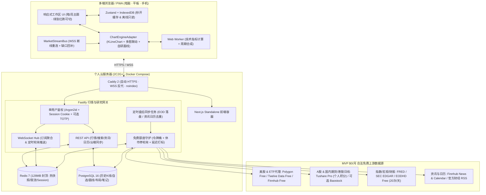
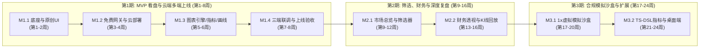

# Trade Buddy — 全球行情研究终端产品与技术规划（v2）

> **文档版本**：`v2.0`（审阅确认后可直接开工，本阶段不编写应用代码）  
> **文档日期**：2026-11-26  
> **核心红线**：原创品牌与设计系统（主名 **Trade Buddy**，禁用 TradingView 商标与专有素材）｜数据源 100% 合法合规、MVP 严格 `$0/月` 免费档且诚实标注延迟｜**面向未成年用户，仅限行情研究与虚拟模拟，严禁真实交易、严禁真实杠杆与券商对接**

> **v1 → v2 修订摘要（依据 `brief/DECISIONS_v2.md` 全部 5 项已确认决策）**
> 1. **品牌定名与视觉升级**：全文替换旧提案「观澜终端 / Meridian Terminal」为正式主名 **Trade Buddy**，补充与之匹配的原创 Logo / 视觉意象与 PWA 应用图标方向。
> 2. **数据预算锁定免费档（`$0/月`）**：重构第 7 节，MVP 全部切换为免费、合法、可个人使用的独立数据源；逐一核对并如实写明各市场实际延迟、免费调用额度与积分限制，将付费套餐全部移入「后续可选付费升级」。
> 3. **聚焦 4 大优先市场**：MVP 优先级聚焦 **美股、A 股、港股、期货与指数**，并据此配置默认 4 组自选表；**加密货币、外汇降级为后期可选扩展市场**。
> 4. **新增云服务器部署与多端访问方案**：新增第 8 节 **「云服务器部署方案」**（低配 `2C2G` 起步规格、Docker Compose、Caddy 自动 HTTPS、单用户轻量鉴权、自动备份与月成本估算）；同步将 MVP 升级为「电脑 / 平板 / 手机浏览器响应式 + PWA」及「云端 PostgreSQL 主存储 + IndexedDB 离线缓存」多端同步架构。
> 5. **明确默认配色与决策归档**：默认涨跌配色确认为 **绿涨红跌（国际习惯）** 并在 Design Tokens 中完整定义 `intl / cn` 切换机制；原第 11 节「待补充信息」改写为「已确认决策」（因新增第 8 节，顺延为第 12 节）。

---

## 目录

1. [产品定位与第一版目标（品牌确认：Trade Buddy）](#1-产品定位与第一版目标品牌确认trade-buddy)
2. [对标分析：对照 21 张截图拆解 TradingView 看盘体验](#2-对标分析对照-21-张截图拆解-tradingview-看盘体验)
3. [信息架构与页面地图](#3-信息架构与页面地图)
4. [全模块功能规划与 MVP 边界（做 / 不做）](#4-全模块功能规划与-mvp-边界做--不做)
5. [UI 设计规范（视觉审美、多端栅格、关键组件与 Design Tokens）](#5-ui-设计规范视觉审美多端栅格关键组件与-design-tokens)
6. [技术架构、推荐栈与仓库目录草案](#6-技术架构推荐栈与仓库目录草案)
7. [合法数据源方案（MVP `$0/月` 免费档、分市场延迟与后续付费升级）](#7-合法数据源方案mvp-0月-免费档分市场延迟与后续付费升级)
8. [云服务器部署方案](#8-云服务器部署方案)
9. [分阶段路线图（第 1 期 / 第 2 期 / 第 3 期）](#9-分阶段路线图第-1-期--第-2-期--第-3-期)
10. [风险、合规与未成年人保护红线](#10-风险合规与未成年人保护红线)
11. [建议的下一步实现顺序（首批落地清单）](#11-建议的下一步实现顺序首批落地清单)
12. [规划完整度自评与已确认决策](#12-规划完整度自评与已确认决策)

---

## 1. 产品定位与第一版目标（品牌确认：Trade Buddy）

### 1.1 品牌命名与原创视觉意象

本项目已正式定名为 **Trade Buddy**（主品牌统一使用英文 **Trade Buddy**，中文副名可选作「研市伴侣 · 行情研究终端」用于介绍文案，界面顶栏与图标统一呈现 **Trade Buddy** / 紧凑缩写 **TB**）。严禁使用 TradingView 名称、Logo、商标化云朵/折线图标或专有字体。

| 品牌维度 | 规划定义 |
|---|---|
| **正式主名** | **Trade Buddy**（紧凑缩写 `TB`，域名与仓库 slug 为 `trade-buddy`） |
| **品牌含义与合规界定** | 强调「冷静、可靠、随时并肩复盘的个人行情研究伙伴」。此处的 `Trade` 指向**市场交易逻辑研究、图表复盘与虚拟模拟学习**，绝不涉及真实实盘交易或券商撮合。 |
| **原创 Logo 图形意象** | **「双柱伴行 + 护盾弧」极简几何标识**：由两根不同高度的极简垂直 K 线柱（左柱沉稳石板蓝、右柱翡翠青绿）与一条贯穿其间的柔和上升折线共同构成抽象的 `TB` 轮廓，外框采用微圆角方形（适配浏览器 Favicon、顶栏 24px 图标与手机/平板 PWA 桌面图标）。线条宽度统一 `1.75px` 几何等宽，清晰锐利，零借用任何现有行情软件视觉符号。 |
| **视觉调性** | **专业金融工作台 + 温和克制的陪伴感**：主画布采用深石板炭灰降低长期盯盘疲劳，界面 chrome 克制冷静，品牌主强调色采用**伴侣钴蓝（`#3B82F6`）**搭配**翡翠青绿（`#16B981`）**，高密度却不压抑。 |

### 1.2 产品定位

**Trade Buddy** 是一款 **自托管部署于个人云服务器、支持电脑 / 平板 / 手机多端浏览器访问（PWA）的全球多市场行情研究终端**。

- **体验定位**：在工作区布局、交互流畅度、信息密度和专业克制的审美上深度对标 TradingView 看盘工作台，让研究者获得接近专业终端的 K 线缩放、画线标注、技术指标叠加、多图联动、自选追踪、复盘笔记与宏观资讯研究体验。
- **核心差异化**：
  1. **原生无付费墙研究体验**：原版 TradingView 基础版将多图布局（见 `multi-layout-basic-limit.png`）、多指标数量、自定义周期等核心能力锁在订阅墙后；Trade Buddy 将 1/2/4 宫格多图、核心指标与 9 类画线工具全部作为个人自托管原生能力提供。
  2. **零订阅费数据策略 + 诚实透明延迟标识**：MVP 严格控制在 **`$0/月` 数据源预算**，每个品种、每条报价都强制展示真实数据属性（`延迟15分` / `IEX参考` / `收盘日线 EOD` / `ETF代理 · 延迟15分`），绝不伪造实时性。
  3. **多端随身复盘、纯粹研究向**：依托个人云服务器实现电脑、平板、手机间自选、画线、布局与笔记自动同步；彻底移除社交喧嚣、营销弹窗（如截图右上角的促销按钮）与真实券商下单入口。

### 1.3 未成年人使用红线（最高优先级约束）

本项目核心使用者为未成年人，以下规则作为**架构级硬约束**写入全周期规划：

1. **绝不接入真实交易**：无券商账户 OAuth、无实盘交易 API、无真实下单/撤单/资金划转模块、图表左上角**禁止出现**类似 TradingView 的 `SELL / BUY` 快捷下单按钮。
2. **绝不提供真实杠杆与融资融券**：即使在第 3 期引入「虚拟模拟研究沙盒（Paper Sandbox）」，也**严格限定为 100% 虚拟本金、1 倍现货模拟（无保证金、无杠杆倍数、无强平机制、无真实衍生品撮合）**，移除 `Account margin`、`Margin buffer` 等杠杆字段。
3. **数据源不依赖实盘券商账户**：未成年人无法合法开立证券/期货实盘账户，因此数据源选型**严禁依赖**需要实盘开户才能调用的券商行情网关（如富途 OpenD、盈透 IBKR Gateway、Alpaca 券商账户等），全部选用独立、合法的第三方公开/个人研究数据 API。
4. **私有自托管保护隐私**：个人云服务器仅开放单用户私有登录（关闭公开注册、禁止搜索引擎收录），不收集未成年人手机号、身份证号或任何金融实名信息。

### 1.4 第一版（MVP）核心目标

在 **8 周内** 交付一个部署在个人低配云服务器（`2C2G` 起步）、**零数据月费（`$0/月`）、流畅美观、支持电脑/平板/手机多端访问**的 Trade Buddy 看盘研究终端：

- 打开域名并完成个人轻量登录后，进入默认**深色专业主题 + 绿涨红跌（可切换）**看盘工作区；
- 聚焦 4 大最高频研究市场：**美股、A 股、港股、期货与指数**（全部走合法免费数据源，严格标注延迟 / EOD / ETF 代理属性）；加密货币、外汇降级至后期可选；
- 拥有 60fps 级流畅缩放与拖拽的 K 线主图 + 成交量 + 核心 8 大技术指标（SMA/EMA/BOLL/VOL/RSI/MACD/ATR/VWAP）；
- 支持最常用的 9 类画线标注工具（趋势线、水平线、射线、平行通道、矩形、斐波那契回撤、文字、箭头、测距尺）+ 磁铁吸附 + 对象树 + 数据窗口；
- 支持全球代码搜索、按 4 大核心市场预设的分组自选表、基础品种详情、1/2/4 宫格多图布局与光标联动、基础新闻流/经济日历抽屉，以及**云端 PostgreSQL + 本地 IndexedDB 多端同步与 JSON 一键备份**。

---

## 2. 对标分析：对照 21 张截图拆解 TradingView 看盘体验

通过完整审阅 `tv-ui-refs/` 目录下全部 21 张 1920×1072 截图，我们可以将 TradingView 专业看盘体验的核心竞争力归纳为**五个维度：极致画布占比、低噪音高密度排版、分层不打断的交互范式、高频操作的肌肉记忆路径、清晰的数据状态语义**。

> **主题说明**：参考截图采集于浅色模式（Light Theme），Trade Buddy 采用**专业深色模式为主（Dark-first），浅色模式为辅**，默认配色为**绿涨红跌（国际习惯，设置内可切换红涨绿跌）**。两套主题共享完全一致的几何栅格、间距、字号层级与交互规范，仅通过语义化 Color Tokens 切换明暗对比。

### 2.1 工作区整体骨架与画布层级

- **引用截图**：`main-workspace.png`、`object-tree.png`、`data-window.png`
- **布局分区**：
  - 整个 1920×1072 桌面视口被极细的 `1px` 分割线（而非厚重阴影卡片）切分为 5 个紧凑区域：
    1. **顶部主工具栏（约 38–40px）**：单行水平排布，左起依次为「Trade Buddy Logo + 品种搜索胶囊（`NVDA`）+ 叠加对比（`+`）｜周期（`D`）｜图表类型｜指标（`Indicators`）｜提醒｜回放｜撤销/重做」，右侧为「多图布局切换｜布局名称与云端保存状态｜快速搜索｜设置齿轮｜全屏｜截图」。
    2. **左侧画线工具栏（约 48–52px）**：纯图标纵向工具条，按功能语义以细横线分为 4 组（光标/线条/通道斐波那契/形态/测算/画笔图形/文字标注｜测距/缩放｜磁铁/连续画线/锁定/隐藏｜清空）。
    3. **中央核心图表区（桌面端占视口面积 >72%）**：由主图区（K 线 + 底部贴底成交量柱 + 公司事件圆标 `D` 分红/`E` 财报）与下方可拖拽高度的副图面板（如 `RSI 14`、`MACD 12 26 9`）垂直堆叠；右侧共享对齐的价格坐标轴（约 68–76px），底部为时间轴 + 快捷时间跨度条（`1D 5D 1M 3M 6M YTD 1Y 5Y All` + 跳转日期）+ 时区时钟（`UTC+8`）与 `ADJ`/`LOG`/`AUTO` 坐标开关。
    4. **右侧可折叠功能抽屉（约 290–320px）**：默认上下分栏——上半为「自选表」，下半为「当前品种详情卡片」，中间带可拖拽分隔条；切换至「对象树/数据窗口」时整栏显示。
    5. **最右侧极窄图标导航轨（约 44px）**：独立垂直停靠，用于一键开关自选、对象树/数据窗口、新闻流、日历、筛选器等右侧面板。
    6. **底部可折叠停靠栏（折叠态约 32px，展开态约 260–300px）**：贴合主图底部，不影响右侧栏全高展示。
- **信息密度与配色**：
  - 视觉权重严格服从「价格 > 标注/指标 > 坐标标签 > 工具栏 chrome」：网格线极淡（低透明度虚线），价格轴上的最新价标签和关键画线价格标签（蓝底 `243.37`、`183.94`）形成高对比锚点。
  - 图表左上角图例行（Status Line）极其紧凑：一行集成「资产图标 + 名称 + 周期 + 交易所 + 开休市状态点 + **不可隐藏的数据来源/延迟胶囊** + OHLC 涨跌色数值」，不占主图高度。
- **必须学到的交互与 Trade Buddy 的取舍**：
  - **学习**：所有数值强制等宽数字（`tabular-nums`），跳动时不抖动；副图与主图共用 X 轴且分隔线可直接拖拽调高；K 线倒计时（日内周期）嵌入最新价坐标胶囊；鼠标悬停图例行才显示隐藏/设置/删除小图标，平时零干扰。
  - **取舍**：**彻底移除**主图左上角的 `SELL / BUY` 买卖快捷按钮、顶栏的 `Trade` 券商下拉和 `Black Friday` 营销按钮，把空间还给数据状态提示与多端云同步状态指示。

### 2.2 画线工具栏、对象树与数据窗口

- **引用截图**：`drawing-toolbar.png`、`object-tree.png`、`data-window.png`
- **布局与交互**：
  - **分组抽屉弹出（`drawing-toolbar.png`）**：左侧工具栏的每个主按钮代表一类工具，点击右侧微箭头展开悬浮二级菜单（如几何图形组内再细分为 `BRUSHES`、`ARROWS`、`SHAPES`），菜单内直接标注快捷键（如 `Rectangle  Alt + Shift + R`）。磁铁按钮激活时以高对比反色胶囊高亮，状态一目了然。
  - **复杂标注承载力（`main-workspace.png`）**：截图中同时叠加了下降趋势线、斐波那契回撤色带（0 / 0.236 / 0.382 / 0.5 / 0.618 / 0.786 / 1 附带实时价位）、半透明紫框阻力区、蓝字中文事件复盘注释，画面依然清晰可读——关键在于**填充色极低透明度（8%–15%）+ 细实线边框 + 标签自动避让**。
  - **对象树（`object-tree.png`）**：与「数据窗口」通过右侧栏顶部 Segmented Toggle 切换，按主图/副图分层列出所有指标与画线对象（`Vol`、`Text`、`Fib retracement`、`Trendline`、`Rectangle`、`Horizontal line`、`RSI`、`MACD`），支持显隐、锁定、排序与按组管理。
  - **数据窗口（`data-window.png`）**：随十字光标移动实时刷新当前 K 线的日期、`Open / High / Low / Close / Change / Vol` 以及所有指标精确读数（如 RSI 与 RSI-based MA、MACD 柱/快线/慢线），并沿用各曲线自身颜色编码，方便精准复盘。

### 2.3 周期切换、图表类型与指标弹窗

- **引用截图**：`timeframe-bar.png`、`chart-type-menu.png`、`indicator-dialog.png`
- **周期选择器（`timeframe-bar.png`）**：
  - 下拉面板顶置 `+ Add custom interval...`，下方按 `MINUTES / HOURS / DAYS` 折叠分组；选中态采用圆角整行高亮（`1 day`）。高频周期支持「加星固定」到顶栏横向快捷切换（如 `5m 15m 1h 1D 1W`）。对于仅支持日线 EOD 的免费数据源品种（如 A 股/港股日线），不可用的分钟周期以灰态提示并附 Tooltip 说明原因，绝不报错白屏。
- **图表类型菜单（`chart-type-menu.png`）**：
  - 图标 + 文字单列菜单，用细横线分隔为常规柱/K 线（`Bars`、`Candles`、`Hollow candles`）、折线系（`Line`）、面积系（`Area`、`Baseline`）、非时间轴系（二期 `Heikin Ashi`）。空心 K 线（`Hollow candles`）阳线空心绿框、阴线实心红柱，通透度极佳，纳入 MVP。
- **指标弹窗（`indicator-dialog.png`）**：
  - 居中模态框（约 720px 宽，移动端自适应全屏抽屉），顶部全宽搜索框打开自动聚焦，左窄右宽两栏：左侧为来源分类（`Built-in` / 三期 `My Scripts`），右侧为类型筛选胶囊与指标列表，点击即瞬时叠加且支持连续添加。

### 2.4 品种搜索、分组自选表与品种详情/财务透视

- **引用截图**：`symbol-search.png`、`watchlist.png`、`right-sidebar.png`、`main-workspace.png`
- **全局品种搜索（`symbol-search.png`）**：
  - 居中大搜索框支持「代码 / 中英文名称」，下方一排资产大类胶囊按 MVP 优先级排序：**`全部 / 美股 / A 股 / 港股 / 指数 / 期货与大宗代理`**（后期可扩展加密/外汇）。
  - 列表行高紧凑（约 44px），左端圆形市场徽标 + 粗体代码 + 名称 + 微型标签（`US STOCK`、`A股`、`HK STOCK`、`INDEX`、`FUTURES`、`ETF PROXY`），右端展示交易所与数据属性徽标（如 `NASDAQ · 15m延迟`、`SSE · EOD`）。
  - **关键肌肉记忆**：桌面端在图表任意空白处**直接敲击字母/数字**即自动唤起搜索框并带入首字符，回车立即切图。
- **分组自选表（`watchlist.png`）**：
  - 支持多自选清单切换，默认清单严格按已确认的 4 大研究市场分区：**`美股`、`A 股`、`港股`、`期货与指数`**。
  - 四列极简排版：`Symbol`（左对齐）、`Last`、`Chg`、`Chg%`（均右对齐 + 等宽数字）。完整吸收状态微标设计：延迟品种带琥珀色 `D`（Delayed）徽标、收盘日线品种带灰蓝色 `EOD` 徽标、ETF 代理带浅紫色 `代理` 徽标，开休市以绿/灰圆点区分。
- **右侧品种详情与财务透视叠加层（`main-workspace.png`、`right-sidebar.png`）**：
  - 右侧下半区在约 300px 窄栏内展示：大号现价与涨跌幅、开休市状态与数据延迟说明、当日成交量 vs 均量对比、`Key stats` 键值表、6 格阶段涨跌幅热力块（`1W / 1M / 3M / 6M / YTD / 1Y`）。
  - 点击 `More financials` 后（`right-sidebar.png`），在主图区域上方展开「品种财务叠加层（Overlay）」同时保留右侧自选轨，支持 `Overview / Statements / Statistics / Valuation` 切换（二期深度完善，MVP 先提供基础财务摘要与 SEC EDGAR 原文直达）。

### 2.5 资讯流、经济日历与股票筛选器（不离盘面研究）

- **引用截图**：`news-flow.png`、`news-or-calendar.png`、`market-overview-or-screener.png`
- **共同交互范式**：桌面端三者均以**右侧宽抽屉（约占 45%–52% 视口宽度，可拖拽调宽或最大化）**与左侧 K 线并排展示；平板/手机端切换为全屏抽屉或独立底部 Tab，避免挤压画布。
- **经济日历（`news-or-calendar.png`）**：顶部周切换器 + `Today` 快捷按钮 + 7 天横向卡片带；下方重要性柱状过滤 + 国家/分类过滤；主表按日期分组展示时间、国家、重要性条、事件名及 `Actual / Forecast / Prior` 对比。
- **新闻流（`news-flow.png`）**：顶部快捷过滤胶囊 `Watchlist`、`Same as chart`（默认联动当前主图品种！），条目轻量化呈现「关联品种徽标 + 相对时间 + 媒体来源 + 加粗标题（点击外链原文）」。
- **股票筛选器（`market-overview-or-screener.png`）**：二期落地，顶部预设胶囊 + 多条件组合筛选栏 + 高密度虚拟滚动表，点击任意行同步切换主图品种。

### 2.6 多图布局与图表精细化设置

- **引用截图**：`multi-layout.png`、`multi-layout-picker.png`、`multi-layout-basic-limit.png`、`chart-settings.png`、`chart-settings-symbol.png`、`chart-settings-scales.png`、`chart-settings-canvas.png`
- **多图布局选择器**：顶栏弹出布局矩阵，Trade Buddy 在 MVP 直接原生开放 **1 / 2H / 2V / 4 宫格** + `SYNC IN LAYOUT` 联动开关（`Symbol` / `Interval` / `Crosshair` 默认开启 / `Time`），彻底突破原版基础版单图限制。平板支持 1/2 宫格，手机端聚焦单图。
- **图表设置弹窗**：左栏分组导航（`Symbol`、`Status line`、`Scales and lines`、`Canvas`、`Appearance & Color Scheme`、`Shortcuts`；**绝不设**真实 `Trading` 选项卡），涵盖：
  - 涨跌配色方案一键切换（**默认绿涨红跌 `Intl` / 可选红涨绿跌 `CN`**）与实体/边框/影线自定义；
  - 复权开关（前复权/不复权，支持市场有效）、时区（默认 `UTC+8 Shanghai`）；
  - 防标签重叠、K 线收盘倒计时、最高最低价线、网格透明度、画布上下留白（默认 `Top 10% / Bottom 8%`）与右侧留白（默认 `Right 10 bars`）。

### 2.7 底部停靠面板（合规重构）

- **引用截图**：`bottom-panel.png`、`main-workspace.png`
- **Trade Buddy 的合规演进策略**：
  - **第 1 期（MVP）**：底部停靠栏承接 **「品种研究笔记 / 复盘日志（Markdown 轻量记录，与当前品种及画线时间戳绑定，云端同步）」**，默认折叠 32px 最大化图表高度。
  - **第 3 期（模拟研究沙盒）**：在此底部停靠栏增加「虚拟模拟研究（Paper Sandbox）」标签页，**硬编码禁用保证金/杠杆字段**，仅保留「虚拟总资产、可用虚拟现金、持仓市值、虚拟盈亏、净值曲线、复盘交易日志」，并常驻「仅研究模拟 · 虚拟资金 · 无杠杆」合规徽标。

---

## 3. 信息架构与页面地图

### 3.1 总体信息架构（IA）

Trade Buddy 以 **「受单用户鉴权保护的单页沉浸式看盘工作区（`/chart`）」** 为核心，针对桌面、平板、手机三端提供一致的数据模型与自适应视图壳子。

```text
Trade Buddy (https://tb.yourdomain.com)
├── /login (MVP：单用户私有登录页，密码 + 可选 TOTP，未登录拦截所有路由与 API)
├── /chart (默认入口：主看盘工作区，支持 /chart/[market]/[symbol] 直达)
│   ├── 桌面端 5 区框架 / 平板可折叠抽屉框架 / 手机底部 Tab 导航（自选｜图表｜资讯｜笔记）
│   ├── 顶栏工作台控制（TB Logo、品种搜索、周期、图型、指标、多图布局、云同步状态、设置、主题）
│   ├── 左侧画线工具轨（分组抽屉 + 磁铁/锁定/隐藏；平板可收起，手机端轻量查看与快捷画线）
│   ├── 中央多图画布（桌面 1/2/4 宫格，平板 1/2 宫格，手机单图+横屏全屏模式）
│   ├── 右侧可切换抽屉（桌面由最右 44px 图标轨驱动；移动端通过底部 Tab / 抽屉打开）
│   │   ├── 分组自选表（美股 / A股 / 港股 / 期货与指数）+ 品种详情分栏
│   │   ├── 对象树 / 数据窗口（Segmented 切换）
│   │   ├── 资讯新闻流（默认联动当前品种，免费合法源）
│   │   ├── 宏观与财报日历（周视图 + 重要事件）
│   │   ├── 市场筛选器快捷抽屉（二期）
│   │   └── 价格条件提醒面板（二期，纯研究提醒）
│   ├── 主图内覆盖层
│   │   └── 品种基本面与财务透视 Overlay（二期）
│   └── 底部可折叠停靠栏
│       ├── 品种研究笔记 / 复盘日志（MVP，多端云同步）
│       ├── 轻量指标脚本编辑器（三期）
│       └── 虚拟模拟研究沙盒（三期，100% 虚拟现货、无杠杆）
├── /markets（二期：市场总览——美股/A股/港股核心指数矩阵、板块热力图、涨跌速览）
├── /screener（二期：全屏多市场筛选器）
├── /calendar（二期：全屏宏观经济与财报日历）
├── /news（二期：全屏财经资讯流）
└── /settings（MVP：主题与绿涨红跌/红涨绿跌切换、快捷键、免费数据源配额与积分状态看板、安全与 TOTP、JSON 导入/导出、合规声明）
```

### 3.2 关键页面路由规范

| 路由路径 | 页面定位 | 阶段 | 核心特征 |
|---|---|---|---|
| `/login` | 单用户私有登录页 | **MVP** | 极简深色登录卡片，支持密码 + 可选 TOTP；仅个人使用，无注册入口 |
| `/chart` | 默认看盘工作区 | **MVP** | 自动拉取云端上次保存的工作区布局与默认品种（默认 `US:NVDA`） |
| `/chart/[market]/[symbol]` | 指定品种直达看盘 | **MVP** | 如 `/chart/US/NVDA`、`/chart/CN/600519.SH`、`/chart/HK/00700.HK`，支持 `?interval=1D&layout=2h` |
| `/markets` | 核心市场总览与热力图 | 第 2 期 | 美/A/港/期货指数全景条、行业热力图、异动速览 |
| `/screener` | 全屏多市场筛选器 | 第 2 期 | 条件组合构造器 + 虚拟滚动表格，点击行直达 `/chart` |
| `/calendar` | 宏观经济与财报日历 | 第 2 期 | 全屏周/日视图、重要性与国家过滤 |
| `/news` | 全球财经资讯流 | 第 2 期 | 按 4 大核心市场与自选聚合，外链原文阅读 |
| `/settings` | 系统、安全与数据源中心 | **MVP** | 主题/涨跌色切换、快捷键、免费 API 每日配额监控、Tushare 积分能力自检、改密/会话注销、JSON 备份恢复 |

---

## 4. 全模块功能规划与 MVP 边界（做 / 不做）

以下按「研究行情」优先级组织 10 大功能域，明确对应 TradingView 模块、核心交互、MVP/二期/三期归属与技术实现要点。

### 4.1 功能矩阵总览

| # | 功能域 | 对照 TradingView 模块 | 核心交互要点 | MVP（第 1 期） | 第 2 期 | 第 3 期 | 技术实现要点 |
|---|---|---|---|---|---|---|---|
| 1 | **图表工作区** | 主图+副图+顶栏+底轴（`main-workspace.png`, `timeframe-bar.png`, `chart-type-menu.png`, `multi-layout.png`） | 滚轮/双指缩放、拖拽平移、十字光标（手机长按）、价格轴拉伸、1/2/4 宫格联动、坐标切换（普通/对数/自动） | K 线/空心 K/美国线/折线/面积/成交量；周期 1m~1M + 自定义（按市场数据源能力动态启停）；对数/普通/自动；前复权/不复权（A/美股支持源）；桌面 1/2H/2V/4 宫格、平板 1/2 宫格、手机横屏沉浸单图 | 基线图/Heikin Ashi；品种叠加百分比对比（Compare `%`）；K 线回放（Bar Replay）；时间区间同步 | 最多 8 宫格（桌面端）；盘前盘后阴影区与扩展时段视图 | Canvas 2D 高频渲染（`KLineChart` 封装 + 自研适配器），行情推送直通 Canvas 绕过 React 渲染；DPR 与移动端触摸手势适配 |
| 2 | **画线与标注** | 左侧画线栏 + 对象树（`drawing-toolbar.png`, `object-tree.png`） | 点选拖拽绘制、端点微调、选中弹出悬浮样式条、强弱磁铁吸附 OHLC、隐藏/锁定、Undo/Redo、对象树管理 | **核心 9 件套**：趋势线、水平线、射线、平行通道、矩形、斐波那契回撤、文字标注、箭头、测距尺；磁铁吸附；锁定/显隐；基础对象树；**云端同步 + IndexedDB 离线缓存**（手机端支持查看全部标注 + 轻量水平/趋势线） | 扩展图形（圆/椭圆/三角形/画笔/高亮/多空盈亏比测算尺）；画线模板保存；对象树编组与跨周期可见性控制 | 标注快照导出高清 PNG（带 Trade Buddy 原创轻水印） | 基于世界坐标 `(timestamp, price)` 存储而非屏幕像素，跨设备（桌面/平板/手机）与切换对数坐标时精确对齐 |
| 3 | **技术指标** | 指标弹窗 + 图例参数（`indicator-dialog.png`, `data-window.png`） | 搜索即加、主图叠加/自动新建副图、悬停图例调参、数据窗口实时同步各指标精确值 | **核心 7+1 指标**：SMA(MA)、EMA、布林带(BOLL)、成交量(VOL)、RSI(含MA)、MACD、ATR、VWAP（有日内成交量市场）；参数面板；数据窗口 | 扩展指标库（KDJ、Stoch RSI、ADX、OBV、Ichimoku、枢轴点、EMA Ribbon）；指标模板云端保存 | 开放轻量指标脚本引擎，允许用户自定义指标并在弹窗 `My Scripts` 中加载 | 纯 TypeScript 指标计算库运行于 **Web Worker**，低端平板/手机也不卡主线程；支持增量 bar 滚动更新 |
| 4 | **品种搜索与自选** | 搜索弹窗 + 自选栏（`symbol-search.png`, `watchlist.png`） | 桌面键入即搜、市场胶囊过滤、回车切图；默认 4 大市场自选分组、拖拽排序、延迟 `D`/日线 `EOD`/代理徽标 | 全局代码/中英文名搜索（覆盖 **美股、A 股、港股、期货与指数**）；多自选表 + 默认 4 大市场分组；涨跌/延迟/开休市状态徽标；多端云同步 | 迷你走势图（Sparkline）、自定义列（成交量/市值/PE）、色标旗帜分类、CSV 导入导出；**可选开启加密/外汇扩展分组** | 自定义组合板块对比与异动统计 | 后端 PostgreSQL `pg_trgm` 索引检索 <30ms，零额外搜索引擎内存开销；前端 `TanStack Virtual` 支撑流畅滚动 |
| 5 | **行情资讯与日历** | 新闻流 + 经济日历（`news-flow.png`, `news-or-calendar.png`） | 桌面右侧宽抽屉并排查看、手机端独立 Tab；新闻支持 `联动当前品种 / 自选`；日历周卡片与重要性过滤 | 免费合法资讯流（Finnhub Free 美股新闻 + 官方/公开财经 RSS，展示标题/时间/来源并外链原文）；基础宏观经济与美股财报日历（Finnhub Free + FRED 宏观发布日程） | 除权分红日历、图表底轴事件圆标（`E` 财报 / `D` 分红）；A/港股公开公告索引（合法披露渠道）；关键词过滤 | 重大宏观事件自动在 K 线时间轴打标；可选学习向新闻摘要（严守不给投资建议红线） | 服务端定时抓取免费 API + RSS 去重并做代码映射，Redis 缓存，严禁抓取付费墙全文 |
| 6 | **市场总览与筛选器** | 股票筛选器（`market-overview-or-screener.png`） | 预设胶囊 + 多条件筛选条 + 排序表，点击行联动主图 | **MVP 仅做轻量化「四大核心市场指数与自选速览」**，不做重型全市场筛选器与热力图 | **完整落地**：美股/A 股/港股多维筛选器（侧滑抽屉 + 全屏页）、板块热力图（Treemap）、涨跌幅榜 | 自定义筛选方案云保存、跨市场相关性矩阵 | 基于后端每日定时落盘的免费日线/基本面快照在 PostgreSQL 做索引分页查询（<150ms），不增加实时 API 额度压力 |
| 7 | **品种详情与基本面** | 右侧详情区 + 财务覆盖层（`main-workspace.png`, `right-sidebar.png`） | 自选区下方实时跟随选中品种，展示报价、量能对比、关键统计；点击查看财务摘要 | 右侧分栏展示：报价头、市场状态与**数据来源/延迟说明**、今开/昨收/高低/52周区间、量能对比、基础公司简况、阶段涨跌幅热力块（1W~1Y）、美股 SEC EDGAR 公告直达链接 | 完整「财务透视 Overlay」：核心指标、三大报表（美股走免费 SEC EDGAR XBRL + A 股按 Tushare 积分能力覆盖）、P/E & P/S 估值趋势 | 同行业估值对比卡片、财报历史对比笔记 | 财务数据低频变动，服务端按日/按季缓存入 PostgreSQL，几乎零额外流量与内存压力 |
| 8 | **模拟盘（Paper Sandbox）** | 底部面板（`bottom-panel.png`） | 仅在研究场景下用虚拟资金验证思路与仓位管理，强制填写复盘笔记 | **不做**（MVP 底部栏专注「品种研究笔记/复盘日志」，多端云同步） | **不做**（二期专注筛选器、财务透视与 K 线回放） | **三期合规上线**：100% 虚拟本金、**严格 1x 现货模拟（禁杠杆/禁融资/禁保证金/禁实盘）**、市价/限价记录、虚拟净值曲线与强制复盘理由 | 独立虚拟记账引擎仅读取已缓存行情价格，架构层物理隔离任何真实支付与券商网关 |
| 9 | **脚本与策略（指标扩展）** | 指标弹窗 `My Scripts`（`indicator-dialog.png`） | 允许进阶学习者编写自定义指标公式并叠加到图表 | **不做脚本 IDE，也不做 Pine 兼容**；底层指标引擎预留标准化插件接口 | 开放 JSON 参数化组合指标（自定义多均线组、纯研究价格条件提醒） | **三期上线轻量 TS-DSL 指标沙盒**（Web Worker + AST 白名单，支持 `sma/ema/rsi/crossover/plot`） | 首期不做 100% Pine 兼容：避免 6–12 人月历史包袱与语法商标风险，TS-DSL 更安全且适合学习编程思维 |
| 10 | **账户、多端同步与设置** | 设置弹窗（`chart-settings*.png`） | 个人私有登录、多端自动同步、深/浅色切换、**绿涨红跌（默认）/红涨绿跌切换**、快捷键与备份 | **单用户私有登录（密码 + 可选 TOTP）**；**云端 PostgreSQL 主存储 + 前端 IndexedDB 离线缓存**，实现电脑/平板/手机实时同步布局、画线、自选与笔记；深色默认 + 绿涨红跌默认；数据源配额看板；JSON 一键备份恢复 | 样式模板库云同步、多端会话管理与登录审计日志、邮件/WebPush 纯研究价格提醒 | 脱敏只读研究截图/笔记导出（Markdown + PNG） | 配置通过 `Zod` 版本化 Schema 校验，断网或弱网时 IndexedDB 兜底可读，恢复在线后自动按时间戳合并云端 |

### 4.2 MVP「做 / 不做」清晰边界清单

#### ✅ MVP（第 1 期）明确要做
1. **多端响应式专业看盘工作区 + PWA**：桌面完整 5 区工作台、平板侧滑抽屉适配、手机底部 Tab + 横屏沉浸看图，支持手机/平板浏览器「添加到主屏幕」。
2. **`$0/月` 免费合法四大核心市场覆盖**：美股、A 股、港股、期货与指数（含清晰的 `延迟15分` / `IEX参考` / `收盘日线 EOD` / `ETF代理` 不可隐藏徽标），默认 4 组自选表开箱即用。
3. **核心行情渲染与多图布局**：K 线、空心 K 线、美国线、折线、面积图、成交量；普通/对数/自动坐标；支持市场的前复权/不复权；桌面 1/2H/2V/4 宫格（平板 1/2 宫格）及光标/品种/周期联动。
4. **核心 9 类画线工具 + 对象树 + 磁铁吸附 + 数据窗口**：趋势线、水平线、射线、平行通道、矩形、斐波那契回撤、文字、箭头、测距尺，支持 Undo/Redo、显隐、锁定。
5. **核心 8 个内置技术指标（Web Worker 计算）**：SMA、EMA、BOLL、VOL、RSI、MACD、ATR、VWAP。
6. **全局代码搜索 + 分组自选 + 基础品种详情 + 免费新闻/日历抽屉 + 品种研究笔记底栏**。
7. **个人云服务器 Docker Compose 部署 + 单用户私有鉴权 + 多端云端同步**：含自动 HTTPS、默认深色与**绿涨红跌（可切换）**、免费 API 配额监控、每日自动数据库备份与 JSON 导出恢复。

#### ❌ MVP（第 1 期）明确不做
1. **不做** 真实交易、券商对接、下单按钮、真实杠杆/融资融券（**全周期永久禁止**）。
2. **不做** TradingView 私有接口爬虫或任何未授权财经网站爬虫（**全周期永久禁止**）。
3. **不做** 付费行情数据源强制依赖（MVP 严格 `$0/月` 数据预算；付费源列为后续可选升级）。
4. **不做** 加密货币与外汇的默认接入与默认自选（降级为第 2/3 期可选扩展插件）。
5. **不做** 100% Pine Script 语法兼容、重型全市场筛选器、行业热力图、完整三大财务报表覆盖层、K 线回放（移至第 2 期）与虚拟模拟盘（移至第 3 期）。
6. **不做** 公开多用户注册/社交广场/评论区，也不做 iOS/Android 原生 App（MVP 通过响应式 Web + PWA 满足多端访问）。

---

## 5. UI 设计规范（视觉审美、多端栅格、关键组件与 Design Tokens）

### 5.1 视觉审美与品牌呈现原则

- **克制、精准、低视觉疲劳**：以深石板炭灰（而非纯黑 `#000000`）作为主画布底色；所有面板以 `1px` 发丝线（Hairline）切分，最大化数据与图表占比。
- **涨跌配色默认国际习惯（绿涨红跌）且可一键切换**：
  - 默认 `data-color-scheme="intl"`：**翡翠青绿涨（`#16B981`）、珊瑚亮红跌（`#F2485B`）**；
  - 设置页提供一键切换 `data-color-scheme="cn"`（红涨绿跌），全站 K 线实体/边框/影线、成交量柱、自选表涨跌字色、阶段涨跌幅热力块与指标红绿柱瞬时联动，并同步保存至云端用户偏好。
- **语言规范**：界面以**简体中文**为主，市场代码与国际通用金融缩写保留英文（`OHLC / VOL / RSI / MACD / BOLL / ATR / ADJ / LOG / EOD / ETF`），保证专业感与低阅读负担。
- **100% 原创视觉资产**：
  - **Trade Buddy Logo**：顶栏最左侧展示 `22×22px` 原创双柱伴行几何图标 + `Trade Buddy` 半粗体字标（`<1280px` 自动收起文字仅留图标）；PWA 启动图标采用深石板圆角底 + 蓝绿双柱几何标。
  - **图标与字体**：开源 **Lucide Icons**（ISC）+ 自绘 `1.5px` 原创金融几何 SVG；西文字体 `Inter`，中文字体 `Noto Sans SC` / 系统回退，全部价格与时间刻度强制 `font-variant-numeric: tabular-nums`（数据窗口可选 `JetBrains Mono`）。

### 5.2 多端响应式工作区栅格规范

#### 1) 桌面端（`>= 1280px`：完整 5 区专业工作台）

```text
+---------------------------------------------------------------------------------------------+
| TopBar (h: 40px)  [TB Logo][NVDA 🔍][1D v][Candles][Indicators][Layout][Sync✓][Gear][Theme]  |
+----+------------------------------------------------------------------+----------------+----+
| L  | Chart Status Line (Overlay: NVDA · 1D · 延迟15分 · OHLC)         | Watchlist      | R  |
| e  |                                                                  | [美股][A股]... | i  |
| f  |                                                                  |----------------| g  |
| t  |                    Main Candlestick + Volume Pane                | Grouped Rows   | h  |
|    |                      (Resizable Height ~62%)                     | (Virtual List) | t  |
| T  |                                                                  |  Symbol Last % |    |
| o  |------------------------------------------------------------------|================| R  |
| o  | RSI (14) Sub-pane (~19%)                                         | Symbol Details | a  |
| l  |------------------------------------------------------------------| (Resizable     | i  |
| s  | MACD (12, 26, 9) Sub-pane (~19%)                                 |  Bottom Split) | l  |
| 48 |------------------------------------------------------------------|  Price / Stats | 44 |
| px | Time Axis (26px) + Quick Range Bar (1D..All | UTC+8 | LOG | ADJ) |  Perf Tiles    | px |
|    +------------------------------------------------------------------+                |    |
|    | Bottom Dock (Collapsed: 32px | Expanded: 260px — Research Notes) |                |    |
+----+------------------------------------------------------------------+----------------+----+
  48px                     Fluid Canvas (>= 65% width)                     288~340px      44px
```

- `>= 1440px`：完整 5 区展开，右侧栏默认 `312px`；宽抽屉（新闻/日历）展开至 `520px ~ 48vw`。
- `1280px ~ 1439px`：右侧栏收窄至 `272px`，顶栏次要按钮折叠进 `...` 菜单。

#### 2) 平板端（`768px ~ 1279px`：iPad / 安卓平板横竖屏）

- 顶栏高度微调至 `44px`，触控热区 `>= 36px`；
- 左侧画线工具栏默认可一键收起（悬浮按钮呼出），右侧自选/详情/对象树改为**右侧滑出抽屉**，让主图画布占据 `>= 88%` 屏幕面积；
- 多图布局支持 `1 / 2H / 2V`；完整支持双指捏合缩放、单指平移与触控笔（Apple Pencil）精准画线。

#### 3) 手机端（`< 768px`：移动端浏览器 + PWA 主屏幕模式）

```text
+-----------------------------------+
| TopBar (44px): [NVDA ▼] [1D] [⚙] |
| Status: 141.71 +2.35% [延迟15分]  |
+-----------------------------------+
|                                   |
|      Full-width Chart Canvas      |
|      (Pinch Zoom / Long-Press     |
|       Crosshair / Auto Landscape) |
|                                   |
+-----------------------------------+
| Quick Strip: 5m 15m 1h 1D 1W | Ind|
+-----------------------------------+
| Bottom Tabs (52px + safe-area):   |
|  [自选]   [图表*]   [资讯]  [笔记] |
+-----------------------------------+
```

- **交互专项优化**：
  - 支持 `viewport-fit=cover` 与 iOS/Android 安全区（`env(safe-area-inset-bottom)`）；
  - 手机横屏时自动隐藏底部 Tab 栏与冗余 chrome，进入**沉浸式全屏 K 线模式**；
  - 手机图表页默认单指左右滑动平移历史、双指缩放、**长按 250ms 锁定唤起十字光标与浮窗 OHLC 读数**；
  - 手机端完整展示云端同步的所有桌面画线标注，并提供轻量化「画水平线 / 趋势线 / 清空」快捷入口，避免小屏误触。

### 5.3 核心 Design Tokens（Trade Buddy 原创设计系统 v2）

```css
/* ===== Trade Buddy Design Tokens (v2) ===== */
:root,
[data-theme="dark"] {
  /* 1. 背景层级 Surface Hierarchy (深石板冷灰系，拒绝纯黑) */
  --bg-canvas:        #0E1117;   /* 主图画布底色 */
  --bg-panel:         #131722;   /* 顶栏、侧栏、底栏背景 */
  --bg-elevated:      #1B2130;   /* 悬浮菜单、弹窗、抽屉面板 */
  --bg-hover:         #232B3E;   /* 控件悬停态 */
  --bg-active:        #2B364F;   /* 控件激活/选中态 */
  --bg-input:         #0B0E14;   /* 输入框底色 */

  /* 2. 分割线与网格 Borders & Grid */
  --border-hairline:  #222938;   /* 工作区 1px 区域分割线 */
  --border-subtle:    #2D364A;   /* 按钮、输入框边框 */
  --border-focus:     #3B82F6;   /* 聚焦环 */
  --chart-grid:       rgba(148, 163, 184, 0.08);
  --chart-crosshair:  rgba(148, 163, 184, 0.45);

  /* 3. 文字层级 Typography Colors */
  --text-primary:     #E6EDF7;   /* 主标题、现价、主要代码 */
  --text-secondary:   #9AA6BC;   /* 坐标轴刻度、副标题、表头 */
  --text-muted:       #66738A;   /* 辅助说明、占位符、休市文字 */
  --text-inverse:     #0B0E14;   /* 亮色徽标反色文字 */

  /* 4. 品牌强调色 Brand Accent (Trade Buddy 钴蓝) */
  --accent-primary:   #3B82F6;
  --accent-hover:     #2563EB;
  --accent-soft:      rgba(59, 130, 246, 0.14);

  /* 5. 行情语义色 —— 默认国际惯例：绿涨红跌 (data-color-scheme="intl") */
  --market-up:        #16B981;   /* 涨：翡翠青绿 */
  --market-up-soft:   rgba(22, 185, 129, 0.16);
  --market-down:      #F2485B;   /* 跌：珊瑚亮红 */
  --market-down-soft: rgba(242, 72, 91, 0.16);

  /* 6. 数据来源与延迟语义色 Data Provenance Badges */
  --status-live:      #10B981;   /* 实时流（后期可选源） */
  --status-delayed:   #F59E0B;   /* 延迟 15 分钟 D 徽标 */
  --status-iex:       #38BDF8;   /* IEX 单交易所参考 */
  --status-proxy:     #A855F7;   /* ETF 代理参考 */
  --status-eod:       #64748B;   /* 日线收盘 EOD */

  /* 7. 指标默认色板 Indicator Palette */
  --ind-line-1:       #38BDF8;   /* MA5 / MACD Fast */
  --ind-line-2:       #FBBF24;   /* MA20 / Signal / RSI-MA */
  --ind-line-3:       #C084FC;   /* RSI / MA60 */
  --ind-line-4:       #FB7185;   /* BOLL Band / MA120 */
}

/* 可选切换：A股习惯 红涨绿跌 (设置内一键切换) */
[data-theme="dark"][data-color-scheme="cn"] {
  --market-up:        #F2485B;
  --market-up-soft:   rgba(242, 72, 91, 0.16);
  --market-down:      #16B981;
  --market-down-soft: rgba(22, 185, 129, 0.16);
}

[data-theme="light"] {
  --bg-canvas:        #FFFFFF;
  --bg-panel:         #F7F9FC;
  --bg-elevated:      #FFFFFF;
  --bg-hover:         #EDF1F7;
  --bg-active:        #E2E8F2;
  --bg-input:         #F1F4F9;
  --border-hairline:  #E2E7F0;
  --border-subtle:    #CFD7E4;
  --chart-grid:       rgba(15, 23, 42, 0.06);
  --chart-crosshair:  rgba(15, 23, 42, 0.40);
  --text-primary:     #111827;
  --text-secondary:   #4B5563;
  --text-muted:       #8A94A6;
  --text-inverse:     #FFFFFF;
  --market-up:        #0D9668;
  --market-up-soft:   rgba(13, 150, 104, 0.14);
  --market-down:      #E03146;
  --market-down-soft: rgba(224, 49, 70, 0.14);
}

[data-theme="light"][data-color-scheme="cn"] {
  --market-up:        #E03146;
  --market-up-soft:   rgba(224, 49, 70, 0.14);
  --market-down:      #0D9668;
  --market-down-soft: rgba(13, 150, 104, 0.14);
}
```

#### 字号、间距、圆角与 Z-Index 层级规范

| 维度 | Token / 档位 | 具体数值 | 使用场景 |
|---|---|---|---|
| **字号** | `xs / sm / base / md / lg / price-xl` | `11px / 12px / 13px / 14px / 16px / 24px` | 坐标轴刻度与延迟徽标 `11px`；自选行/菜单/状态行 `12–13px`；弹窗标题 `16px`；详情大报价 `24px` |
| **字体族** | `--font-sans` / `--font-mono` | `Inter, "Noto Sans SC", sans-serif` / `"JetBrains Mono", monospace` | 所有价格、涨跌幅、成交量、坐标轴强制 `font-variant-numeric: tabular-nums` |
| **间距** | 4px 基数体系 | `2 / 4 / 6 / 8 / 12 / 16 / 20 / 24px` | 极紧凑控件内边距 `4–6px`，模块留白 `12–16px`，弹窗内边距 `20px` |
| **圆角** | `xs / sm / md / lg / full` | `3px / 4px / 6px / 10px / 9999px` | 价格坐标胶囊 `3px`，工具栏按钮 `4px`，下拉/弹窗 `8–10px`，市场筛选胶囊 `full` |
| **Z-Index** | 分层防遮挡体系 | `canvas: 1` → `chart-overlay: 10` → `floating-toolbar: 20` → `dock-panels: 30` → `dropdown/flyout: 40` → `modal-backdrop: 50` → `modal: 60` → `toast/tooltip: 70` | 保证画线悬浮属性条不遮挡弹窗，移动端抽屉与搜索框始终居顶 |

### 5.4 关键组件交互细则

1. **图例状态行（Chart Legend）**：始终贴主图左上角，显示资产徽标、代码、周期、交易所、开休市圆点、**不可隐藏的数据来源与延迟胶囊（如 `延迟15分` / `IEX参考` / `收盘日线 EOD` / `ETF代理 · 延迟15分`）**、OHLC 与涨跌幅；下排显示成交量及主图叠加指标，悬停单条指标浮现「隐藏 / 设置 / 删除」。
2. **画线悬浮样式条（Floating Drawing Bar）**：点击已绘图形后浮现可拖拽样式条，提供「线条色 / 填充色 / 线宽 / 线型 / 文字编辑 / 锁定 / 置顶 / 删除」。
3. **全局快捷键体系（桌面端）**：
   - 任意字母/数字：打开品种搜索；`/`：打开指标搜索；
   - `Alt + T` 趋势线、`Alt + H` 水平线、`Alt + F` 斐波那契、`Alt + R` 矩形、`Shift + 拖拽` 测距尺；
   - `Ctrl/Cmd + Z` / `Y`：撤销与重做；`Delete / Backspace`：删除选中画线；`Esc`：退回十字光标；
   - `Alt + S`：截图导出 PNG；`Alt + L`：切换对数坐标。

---

## 6. 技术架构、推荐栈与仓库目录草案

### 6.1 核心图表渲染引擎选型论证

| 方案 | 渲染技术 | 优势 | 劣势 / 风险 | 结论 |
|---|---|---|---|---|
| **方案 1：TradingView `lightweight-charts` v5（Apache 2.0）** | Canvas 2D | 性能极佳、体积小、v5 支持多窗格 | 原生无完整画线/斐波那契/对象树，且源码归属 TradingView 存在品牌边界顾虑 | 不作为首选内核 |
| **方案 2：开源 `KLineChart` v9/v10（Apache 2.0）+ 自研抽象与交互层** | 分层 Canvas 2D（主画布 + 覆盖层 + 坐标层） | **100% 脱离 TradingView 生态**；原生支持多副图、空心 K/美国线/面积图、对数坐标、自定义 Overlay 与触控缩放；DPR 锐利渲染、60fps 流畅交互 | 对象树、多图联动与高审美斐波那契/悬浮样式条需我们在 Overlay API 上二次封装 | **✅ MVP 首选方案** |
| **方案 3：完全自研 Canvas 2D + WebGL2 引擎** | Canvas 2D / WebGL2 | 终极可控 | 首期耗时 4–6 个月，拖慢交付 | 三期可选升级方向 |

**核心架构决策**：采用 **「可插拔引擎适配器模式（`IChartEngine`）」** + **行情直通 Canvas 通道（`MarketStreamBus`）**：
- 所有报价更新绕过 React State / Zustand 整树重渲染，直接触发图表实例 `updateBar()` 与自选表的增量单元格更新，保证低配手机浏览器与桌面四宫格同样维持 60fps。

### 6.2 推荐全栈技术选型（兼顾低配云服务器与多端体验）

| 层级 | 推荐技术 | 选型理由（含低配云服务器考量） |
|---|---|---|
| **前端框架** | **Next.js 15（App Router，`output: 'standalone'`）+ React 19 + TypeScript 5 + PWA** | `standalone` 产物极精简，容器常驻内存 <200MB；配合 `manifest.json` 实现手机/平板类原生桌面图标体验 |
| **样式与组件** | **Tailwind CSS v4 + CSS Variables Tokens + Radix UI** | 原子化高密度排版 + 暗/亮与绿涨红跌/红涨绿跌零闪烁切换；Radix 兼顾桌面键盘导航与移动端抽屉无障碍交互 |
| **状态与缓存** | **Zustand（+ Immer）+ TanStack Query + Dexie.js（IndexedDB）** | Zustand 管理工作区与对象树；TanStack Query 管理 REST 请求；IndexedDB 做本地离线与秒开缓存，后端 PostgreSQL 做多端主存储 |
| **高频大表** | **TanStack Table + TanStack Virtual** | 流畅支撑自选、新闻流、二期筛选器大表滚动 |
| **后台计算** | **Web Workers（Comlink 封装）** | 技术指标计算与自定义周期合成全部离主线程执行，保护移动端帧率 |
| **后端 BFF 与网关** | **Node.js 22 + Fastify（TypeScript）+ `@fastify/websocket` + 单用户 Auth** | 全栈共享 Zod 类型契约；内存占用低（<200MB）；内置单用户密码/TOTP 鉴权、配额令牌桶与多端云同步接口 |
| **数据适配层** | **插件化 `MarketDataAdapter` + 可选轻量 Python Cron（Baostock 补丁）** | 统一标准化 Polygon/Twelve Data/Finnhub/Tushare/FRED/EODHD 异构数据为内部 `NormalizedBar / NormalizedQuote / DataProvenance` |
| **数据库与缓存** | **PostgreSQL 16（`pg_trgm` + 复合索引）+ Redis 7（`maxmemory 128mb`）** | 个人单用户规模下，标准 PostgreSQL 16 配合 `(symbol, interval, ts)` 复合索引即可毫秒级查询数千万根 K 线，内存仅占 ~200MB（4GB 以上服务器可按需启用 TimescaleDB 扩展）；Redis 严格封顶内存用于热快照、限流令牌桶与 Session |
| **反向代理与部署** | **Docker Compose + Caddy 2** | Caddy 内存仅 ~30MB，零配置自动签发/续期 Let's Encrypt HTTPS 证书并原生支持 `wss://` 代理 |
| **工程管理** | **pnpm Workspaces + Turborepo + GitHub Actions（构建镜像）+ Vitest + Playwright** | **CI 构建 Docker 镜像推送至 GHCR，低配云服务器仅 `docker compose pull` 运行**，彻底避免在 2C2G 服务器上构建导致 OOM |

### 6.3 系统架构图



### 6.4 仓库目录结构草案（Monorepo）

```text
trade-buddy/
├── apps/
│   ├── web/                          # Next.js 15 Standalone + PWA 前端应用
│   │   ├── app/
│   │   │   ├── login/                # (MVP) 单用户私有登录页
│   │   │   ├── chart/[[...slug]]/    # (MVP) 核心看盘工作区（三端响应式）
│   │   │   ├── markets/              # (二期) 市场总览与热力图
│   │   │   ├── screener/             # (二期) 多市场筛选器
│   │   │   ├── calendar/             # (二期) 宏观经济与财报日历
│   │   │   ├── news/                 # (二期) 全球财经资讯流
│   │   │   └── settings/             # (MVP) 偏好/配色切换/免费额度看板/安全/JSON备份
│   │   ├── components/
│   │   │   ├── workspace/            # TopBar, LeftDrawingBar, RightRail, BottomDock, MobileTabBar
│   │   │   ├── chart/                # MultiChartGrid, ChartPane, LegendBar, FloatingDrawBar
│   │   │   ├── panels/               # WatchlistPanel, SymbolDetails, ObjectTree, DataWindow, NewsDrawer, CalendarDrawer
│   │   │   └── dialogs/              # SymbolSearchModal, IndicatorModal, ChartSettingsModal
│   │   ├── stores/                   # workspaceStore, watchlistStore, drawingStore, settingsStore
│   │   └── workers/                  # indicator.worker.ts, resample.worker.ts
│   └── gateway/                      # Fastify 后端 API + WebSocket 网关 + 定时任务
│       ├── src/
│       │   ├── routes/               # /v1/auth, /v1/sync, /v1/symbols, /v1/bars, /v1/news, /v1/calendar, /v1/quota
│       │   ├── ws/                   # subscriptionHub.ts, pollScheduler.ts, heartbeat.ts
│       │   ├── jobs/                 # eodSync.job.ts, calendarSync.job.ts, newsIngest.job.ts
│       │   └── middleware/           # sessionAuth.ts, loginRateLimit.ts, quotaGuard.ts, provenanceTagging.ts
├── packages/
│   ├── chart-core/                   # IChartEngine 抽象、KLineChart 适配器、多图联动、画线世界坐标引擎
│   ├── indicators/                   # 纯 TS 技术指标计算库 (MA/EMA/BOLL/RSI/MACD/ATR/VWAP + 单测)
│   ├── market-adapters/              # 合法免费适配器 (polygon-free, twelvedata-free, finnhub-free, tushare, fred, sec-edgar, eodhd-free)
│   ├── shared-types/                 # 前后端共享 Zod Schema 与 TS 类型 (Bar, Quote, Provenance, Drawing, Layout, Sync)
│   └── ui-tokens/                    # Trade Buddy 原创 Logo SVG、金融图标集、深/浅与 intl/cn Design Tokens
├── deploy/                           # 个人云服务器部署编排
│   ├── docker-compose.yml            # Caddy + Web + Gateway + PostgreSQL + Redis
│   ├── Caddyfile                     # 自动 HTTPS、WSS 反代与安全响应头
│   ├── backup.sh                     # 每日 pg_dump + rclone 异地加密备份脚本
│   └── .env.example                  # 单用户密码哈希、各免费数据源 API Key 模板
├── docs/
│   ├── PLAN.md                       # 本规划主文档 (v2)
│   └── COMPLIANCE.md                 # 版权、数据授权与未成年人使用合规守则
├── .github/workflows/build-push.yml  # CI 构建轻量 Docker 镜像推送至 GHCR
├── package.json
├── pnpm-workspace.yaml
└── turbo.json
```

---

## 7. 合法数据源方案（MVP `$0/月` 免费档、分市场延迟与后续付费升级）

> **诚实与零费用原则**：根据已确认决策，Trade Buddy 第一版（MVP）数据预算严格锁定 **`$0/月`（免费档）**，且聚焦 **美股、A 股、港股、期货与指数** 四大核心市场。以下如实拆解每个市场在免费、合法、免实盘券商账户前提下**真实能拿到什么数据、延迟多少、额度限制如何**，绝不夸大实时性，绝不爬取 TradingView 或任何交易所/财经网站私有接口。

### 7.1 MVP 免费档（`$0/月`）四大核心市场与资讯数据源矩阵

| 资产市场（MVP 优先级） | 合法免费数据源组合（`$0/月`） | 实际数据覆盖与真实延迟 | 免费额度 / 积分硬限制（实测口径） | 界面强制标注徽标 | 合规与 ToS 边界 |
|---|---|---|---|---|---|
| **1. 美股与美股 ETF**<br>（NVDA, AAPL, SPY, QQQ 等） | **主历史源**：**Polygon.io (Massive) Stocks Free** + **Twelve Data Free**<br>**报价/新闻/日历**：**Finnhub Free**<br>**基本面原文**：**SEC EDGAR 官方免费 API** | • **历史日线 & 分钟线（1m~1D）**：Polygon Free 提供近 2 年历史（**收盘 EOD / 15 分钟延迟**）；Twelve Data Free 提供美股日内分钟与日线（**延迟 15 分钟 / IEX**）<br>• **盘中报价刷新**：Finnhub Free REST 报价（**准实时 IEX 或 15 分钟延迟**，无全市场 SIP 逐笔） | • **Polygon Free**：`5 次/分钟` REST，无实时 WS，历史限近 2 年<br>• **Twelve Data Free**：`8 次/分钟`、`800 次/天`（Basic 白名单主要覆盖美股/部分指数）<br>• **Finnhub Free**：`60 次/分钟` REST（免费档已收紧历史 K 线，主要用于最新报价/新闻/日历）<br>• **SEC EDGAR**：免费，`<= 10 次/秒` | `延迟15分` / `IEX参考` / `收盘日线 EOD` | 全部为官方独立数据 API，限个人研究自用，禁止公开多用户再分发；SEC EDGAR 须带合规 `User-Agent` |
| **2. A 股**<br>（上交所、深交所、沪深核心个股与指数） | **主源**：**Tushare Pro**（用户已有账号）<br>**免费开源补充**：**Baostock**（免注册开源数据接口，用于补充复权或盘后历史分钟复盘） | • **日线与指数日线**：**收盘日线（EOD）**，通常交易日盘后 16:30–18:00 更新<br>• **盘中实时/分钟线**：**免费档无法合法获取盘中实时流**（Baostock 仅提供盘后更新的历史 5/15/30/60 分钟 K 线用于课后复盘） | • **Tushare Pro 积分硬约束**（务必按账号实际积分核对）：<br>  - `120 积分`（基础免费）：A 股列表、`daily` 日线、`index_daily`（约 50–200 次/分）<br>  - `2000 积分+`：解锁 `adj_factor`（复权因子）、`daily_basic`（PE/PB/市值/换手）、周/月线、港股与期货日线<br>  - **分钟线（`stk_mins`）与实时快照需额外高阶付费**，免费档不可用<br>• **Baostock**：完全免费无积分门槛，适合盘后定时拉取落盘 | `收盘日线 EOD`（若启用 Baostock 历史分钟则标 `盘后分钟历史`） | Tushare 明确限个人学习研究；**绝不选用依赖爬虫抓取东方财富/新浪私有接口的方案**，也不依赖需成年人实名开户的券商网关 |
| **3. 港股**<br>（恒指 HSI、00700、09988、03690 等） | **诚实说明**：HKEX 授权极严，免费档**无稳定盘中 15 分钟延迟分钟线**。<br>**合法免费组合**：<br>① **Tushare Pro `hk_daily`**（需用户账号满足约 `2000+` 积分）<br>② **EODHD Free**（盘后仅同步自选表内少量核心港股日线）<br>③ **美股 ADR / 港股 ETF 代理对照**（如 `BABA`、`EWH`、`KWEB` 走美股免费源） | • **港股正股**：仅可合法拿到 **收盘日线（EOD）**，**无免费实时、无免费盘中分钟线**<br>• **ADR / ETF 代理对照**：享有美股免费档 **延迟 15 分钟** 与日内分钟线研究能力 | • **Tushare `hk_daily`**：受积分权限与每分钟频次限制（未达积分时回退至 EODHD Free）<br>• **EODHD Free**：极严格——仅 **`20 次/天`**，故网关设计为**仅在港股收盘后（16:30）对自选内 Top 10–15 只港股各拉 1 次日线增量并永久入库**，本地无限次看盘完全够用<br>• 注：Twelve Data Free、Polygon Free 均不覆盖港股 | 正股标 `收盘日线 EOD`；ADR/ETF 标 `ADR/ETF代理 · 延迟15分` | 严格遵守 EODHD/Tushare 个人研究配额；明确告知用户正股与 ADR 存在汇率及交易时段差异 |
| **4. 期货与指数**<br>（国内商品/股指期货、全球核心指数、黄金/原油/美债） | **诚实说明**：CME/ICE/国内期货交易所实时与盘中分钟数据均需昂贵商业授权，免费档不可得。<br>**合法免费组合**：<br>① **国内期货与 A 股指数**：**Tushare Pro**（`fut_daily` 需约 `2000` 积分、`index_daily`）+ Baostock 指数日线<br>② **海外指数与大宗/宏观官方序列**：**FRED（美联储官方免费 API）** + **Twelve Data Free**（部分白名单指数如 `SPX/IXIC/DJI`）<br>③ **盘中日内研究代理**：美股合法 **ETF 代理映射**（`SPY/QQQ/GLD/SLV/USO/TLT/UUP`） | • **国内期货 & 全球宏观/大宗基准**：**收盘日线（EOD）** 或 **官方滞后 1 日序列（FRED）**<br>• **美股 ETF 代理**：跟随美股免费源，支持 **延迟 15 分钟 + 日内分钟 K 线** | • **FRED**：完全免费，几乎无个人研究瓶颈（支持 SP500、NASDAQCOM、VIX、WTI/Brent 原油、美债收益率等官方序列）<br>• **Tushare `fut_daily`**：需 2000 积分档<br>• **ETF 代理**：共享美股免费源配额（Polygon 5 次/分 + Twelve Data 800 次/天） | 期货/基准指数标 `收盘日线 EOD`；代理标的强制标 `ETF代理 · 延迟15分` | 界面在品种详情卡清晰区分「现货/期货合约 EOD」与「ETF 跟踪代理」，避免将 ETF 净值误判为期货合约点位 |
| **新闻资讯与经济日历** | **Finnhub Free**（美股公司新闻、市场新闻、财报日历）+ **官方公开财经 RSS**（如美联储/SEC/央媒及交易所公开公告 RSS，仅取标题、摘要与原站链接）+ **FRED 宏观数据发布表** | 新闻 **1–5 分钟级** 定时轮询聚合；宏观与财报日历按小时同步 | Finnhub Free `60 次/分`；官方 RSS 免费（遵循 5–15 分钟礼貌抓取间隔） | `资讯摘要 · 外链原文` | **只存标题、简短摘要、时间与原链**，绝不抓取付费墙全文，点击跳转原站阅读 |

> **关键诚实结论（供审阅确认）**：在 **`$0/月` 免费档**下，Trade Buddy 可以非常扎实、优雅地支撑 **「美股（延迟 15 分钟 + 完整日内分钟/日线）+ A 股（收盘日线/复权研究）+ 港股（自选核心标的收盘日线 + ADR/ETF 盘中代理）+ 期货与指数（国内期货/FRED 官方日线 + 美股 ETF 盘中代理）」** 的每日专业画线、指标分析与复盘研究；但**不承诺**免费档下 A 股/港股/期货的盘中实时或盘中分钟推送。

### 7.2 默认自选组配置（按 4 大核心市场预设）

首次初始化系统时，后端自动写入以下 4 个默认自选分组（用户登录后可自由增删改排序并多端同步）：

| 自选分组 | 预置核心品种示例 | 免费数据源归属 | 默认状态徽标 |
|---|---|---|---|
| **美股** | `NVDA`、`AAPL`、`MSFT`、`AMZN`、`GOOGL`、`META`、`TSLA` | Polygon Free + Twelve Data Free + Finnhub Free | `延迟15分` / `IEX参考` |
| **A 股** | `600519.SH`（贵州茅台）、`300750.SZ`（宁德时代）、`600036.SH`（招商银行）、`002594.SZ`（比亚迪）、`688981.SH`（中芯国际） | Tushare Pro / Baostock | `收盘日线 EOD` |
| **港股** | `00700.HK`（腾讯控股）、`09988.HK`（阿里巴巴-W）、`03690.HK`（美团-W）、`01810.HK`（小米集团-W）、`00883.HK`（中国海洋石油）；附快捷对照 `BABA` / `KWEB` | Tushare `hk_daily` / EODHD Free（日线）+ 美股免费源（ADR/ETF 对照） | `收盘日线 EOD` / `ADR代理 · 延迟15分` |
| **期货与指数** | `000001.SH`（上证指数）、`000300.SH`（沪深300）、`SPY`（标普500代理）、`QQQ`（纳指100代理）、`GLD`（黄金代理）、`USO`（美油代理）、`TLT`（20年美债代理）、`AU0`（沪金主连）、`IF0`（沪深300期指） | Tushare + FRED + 美股免费源（ETF 代理） | `收盘日线 EOD` / `ETF代理 · 延迟15分` |

### 7.3 免费额度精细化省流、缓存与断线重连架构

由于免费档 API 配额宝贵（如 Polygon `5 req/min`、Twelve Data `800 req/day`、EODHD `20 req/day`），网关层将**省额度设计为核心工程指标**：

1. **三层缓存 + 闭合 K 线永久落盘**：
   - **L1 浏览器 IndexedDB**：缓存最近查看品种的 K 线切片，电脑/平板/手机切回已看品种 `<50ms` 首屏出图；
   - **L2 服务端 Redis（128MB 封顶）**：缓存热报价（TTL 15–60s）、日内未闭合 K 线与新闻/日历列表（TTL 180–600s）；
   - **L3 PostgreSQL 历史表**：所有已闭合（Closed）的历史日线/分钟 K 线一旦拉取即永久落盘，二次查看 **100% 命中本地库，零外部 API 消耗**，实际节省 95% 以上配额。
2. **分市场交易时段感知（休市零轮询）**：
   - 网关内置美股（美东时区含夏令时）、A 股、港股交易日历与开闭市时段表；
   - **EOD 市场（A 股、港股正股、国内期货）**：盘中不发起无效轮询，仅在每日收盘后（如 17:00 / 18:30）由定时任务批量增量拉取 1 次自选清单的当日收盘 K 线入库；
   - **美股与 ETF 代理**：仅在美股开盘时段且当前有已登录客户端在线查看时，按 30–60s 温和节拍拉取活跃自选快照；无客户端在线或休市时自动进入零请求静默模式。
3. **配额令牌桶与可视化看板**：
   - 每个免费适配器绑定独立 Redis 令牌桶（如 Polygon 严格限 `4 req/min` 留余量、EODHD 严格限 `18 req/day`），超额时优雅降级返回缓存数据并在图例提示「今日免费额度已达上限，展示最新缓存」，绝不触发上游封禁；
   - 在 `/settings` 页提供「免费数据源配额与 Tushare 积分状态面板」，每日余量一目了然。
4. **断线重连与缺口自动回补（Gap Backfill）**：
   - 客户端 `MarketStreamBus` 采用指数退避重连（`1s → 2s → 4s → 8s → max 30s` + 抖动）与 25s 心跳；
   - 手机锁屏切回前台或弱网恢复后，自动对比 `lastBarTimestamp` 向网关增量补齐缺失 K 线；断连超过 5 秒时图例状态点变橙色 `重连中...`。

### 7.4 后期降级/可选扩展市场与后续付费升级路径

#### A. 降级为后期可选的市场（第 2–3 期按插件开关启用）
- **加密货币（可选）**：Binance / Coinbase Exchange 公开 WebSocket（免费、毫秒级实时、免登录）；因不属于用户首期高频研究范围，不进入 MVP 默认自选，二/三期可通过设置中的「扩展市场开关」按需启用。
- **外汇与贵金属参考价（可选）**：Twelve Data / Finnhub Forex 参考价（标注 `参考价 Indicative`），同样作为后期可选市场插件。

#### B. 后续可选付费升级路径（当研究深度提升、愿意投入预算时平滑切换，零代码重构）

| 未来升级痛点 | 推荐合法付费个人档 | 参考费用 | 升级后带来的真实提升 |
|---|---|---|---|
| **解锁港股/全球指数 15 分钟延迟分钟线 + 更高美股配额** | **Twelve Data Grow** | 约 `$29/月` | 覆盖港股 HKEX、美股、全球主要指数分钟线与 WebSocket，彻底摆脱 800 次/天限制 |
| **解锁美股无限次 REST 与更长历史深度** | **Polygon.io (Massive) Stocks Starter** | 约 `$29/月` | 美股 5 年+ 历史、无限次 REST 调用（15 分钟延迟），支持盘前盘后与更全复权 |
| **解锁港/美/全球多市场 EOD + 基础财务报表** | **EODHD All-In-One 个人档** | 约 `$19.99–$79.99/月` | 每日 10 万次调用，覆盖港/美/A 股日线、除权分红与财报数据 |
| **解锁 A 股盘中历史分钟级数据** | **Tushare Pro 积分/分钟单独权限** | 按官方积分/套餐规则 | 补齐 A 股分钟级研究与更全基本面财务因子 |
| **解锁美股全市场 SIP 实时流（高阶）** | **Polygon Developer / Advanced** | 约 `$79–$199/月` | 美股全市场合并带（SIP）毫秒级实时推送（个人非专业用途） |

---

## 8. 云服务器部署方案

根据已确认决策，Trade Buddy 部署于**个人云服务器**，面向电脑、平板、手机多端浏览器访问。本节专门针对**低配高性价比云服务器**设计轻量、安全、免维护的容器化落地架构。

### 8.1 服务器规格建议与低配资源预算

| 规格档位 | 推荐配置 | 适用说明 | 预估月费 |
|---|---|---|---|
| **最低可运行档（起步推荐）** | **2 vCPU / 2 GB RAM / 40 GB SSD**（1–5 Mbps 带宽 + 开启 **2 GB Swap**） | 个人单用户完全流畅；需遵循「CI 构建镜像，服务器只拉取运行」与数据库内存限制 | 约 `¥25 – ¥38 / 月`（`$3.5 – $5.5 / 月`） |
| **舒适推荐档（省心首选）** | **2 vCPU / 4 GB RAM / 50–80 GB SSD** | 内存裕度翻倍，可同时容纳二期筛选器快照与可选 TimescaleDB 扩展，无 OOM 焦虑 | 约 `¥40 – ¥60 / 月`（`$6 – $8.5 / 月`） |

#### 关键低配优化与地域选型建议
1. **常驻内存精算（2C2G 环境下控制在 ~800MB – 1.1GB）**：
   - `caddy`：`~30 MB`（内存硬上限 `64M`）
   - `web`（Next.js `standalone`）：`~150–220 MB`（`NODE_OPTIONS=--max-old-space-size=256`，上限 `384M`）
   - `gateway`（Fastify + 调度器）：`~150–220 MB`（`NODE_OPTIONS=--max-old-space-size=256`，上限 `384M`）
   - `postgres`（PostgreSQL 16 标准版，`shared_buffers=256MB`，`max_connections=30`）：`~200–300 MB`（上限 `512M`）
   - `redis`（Redis 7 Alpine，`maxmemory 128mb --maxmemory-policy allkeys-lru`）：`~60–120 MB`（上限 `192M`）
   - **铁律**：绝不在 2C2G 云服务器上直接跑 `pnpm build` / `next build`！全部通过免费的 **GitHub Actions** 编译并推送精简 Docker 镜像到私有 GHCR，云服务器只需 `docker compose pull && docker compose up -d` 完成零卡顿更新。
2. **服务器地域与备案合规提醒**：
   - **优先推荐：中国香港 / 新加坡 / 日本轻量应用服务器**。原因有三：
     1. **免 ICP 备案**：中国大陆服务器绑定域名开启 80/443 必须进行工信部个人 ICP 备案（通常要求年满 18 周岁，未成年人无法独立备案）；海外/香港节点无需备案，买完域名即可直连自动 HTTPS；
     2. **直连海外免费金融 API 稳定**：可顺畅访问 Polygon、Twelve Data、Finnhub、FRED、SEC EDGAR，同时访问 Tushare 也很快；
     3. **国内多端浏览器延迟低**：香港/新加坡到国内主流宽带与 4G/5G 延迟通常在 35–80ms，看盘丝滑。
   - **购买合规提示**：未成年人购置云服务器与域名应由**家长/监护人协助实名购买与管理账单**。

### 8.2 Docker Compose 容器化部署架构

所有容器运行于独立内部网桥 `tb-internal`，**宿主机防火墙（UFW/安全组）仅放行 `22`（SSH 密钥登录）、`80`、`443` 三个端口**，`postgres` 与 `redis` 严禁映射公网端口。

```yaml
# deploy/docker-compose.yml（架构规划草案，非最终应用代码）
services:
  caddy:
    image: caddy:2-alpine
    restart: unless-stopped
    ports:
      - "80:80"
      - "443:443"
    volumes:
      - ./Caddyfile:/etc/caddy/Caddyfile:ro
      - caddy_data:/data
      - caddy_config:/config
    deploy:
      resources: { limits: { memory: 64M } }
    networks: [tb-internal]

  web:
    image: ghcr.io/<owner>/trade-buddy-web:latest
    restart: unless-stopped
    environment:
      - NODE_OPTIONS=--max-old-space-size=256
      - NEXT_PUBLIC_APP_NAME=Trade Buddy
    deploy:
      resources: { limits: { memory: 384M } }
    networks: [tb-internal]

  gateway:
    image: ghcr.io/<owner>/trade-buddy-gateway:latest
    restart: unless-stopped
    env_file: [.env]
    environment:
      - NODE_OPTIONS=--max-old-space-size=256
      - ALLOW_SIGNUP=false
    depends_on: [postgres, redis]
    deploy:
      resources: { limits: { memory: 384M } }
    networks: [tb-internal]

  postgres:
    image: postgres:16-alpine
    restart: unless-stopped
    command: postgres -c shared_buffers=256MB -c max_connections=30 -c work_mem=4MB
    environment:
      - POSTGRES_DB=trade_buddy
      - POSTGRES_USER=tb_user
      - POSTGRES_PASSWORD=${PG_PASSWORD}
    volumes:
      - pg_data:/var/lib/postgresql/data
    deploy:
      resources: { limits: { memory: 512M } }
    networks: [tb-internal]

  redis:
    image: redis:7-alpine
    restart: unless-stopped
    command: redis-server --maxmemory 128mb --maxmemory-policy allkeys-lru --appendonly no
    deploy:
      resources: { limits: { memory: 192M } }
    networks: [tb-internal]

networks:
  tb-internal:
    driver: bridge

volumes:
  caddy_data:
  caddy_config:
  pg_data:
```

### 8.3 域名、HTTPS 与可选「零公网暴露」方案

1. **标准域名 + Caddy 自动 HTTPS（推荐，多端浏览器直连最方便）**：
   - 准备一个自定义域名（如 `tb.yourdomain.com`），在 Cloudflare/DNS 处添加 A 记录指向云服务器公网 IP；
   - `Caddyfile` 自动完成 TLS 1.3 证书签发与每 60 天自动续期，同源路由避免一切跨域问题：
     - `/api/*` 与 `/ws/*` → 反向代理至 `gateway:4000`（原生透传 WebSocket Upgrade）；
     - 其余路径 → 反向代理至 `web:3000`；
     - 统一注入安全响应头：`Strict-Transport-Security`、`X-Frame-Options: DENY`、`X-Content-Type-Options: nosniff`、`X-Robots-Tag: noindex, nofollow`。
2. **零域名 / 零公网端口替代方案（Tailscale 私有组网，可选）**：
   - 若不想购买域名或希望服务器**完全不暴露在公网**，可在云服务器与个人电脑/平板/手机上安装免费版 **Tailscale**（个人免费支持最多 100 台设备），配合 Tailscale MagicDNS + 内置 HTTPS 证书访问，外网黑客与扫描器完全不可见，安全等级更高且省去域名费。

### 8.4 登录鉴权与私有安全加固（仅个人使用）

部署到公网后，登录鉴权不仅是隐私保护，更是**防止陌生人蹭用个人免费 API 额度与违反数据源非再分发条款的底线**：

1. **单用户账号体系（无公开注册）**：
   - 系统启动时仅支持唯一管理员账号（用户名与 `Argon2id` 密码哈希通过 `.env` 注入或首次 CLI 初始化写入数据库），代码层面硬编码 `ALLOW_SIGNUP=false`，无注册页面与注册接口。
   - 强烈推荐在 `/settings` 开启 **TOTP 两步验证**（绑定任意开源验证器 App），手机/电脑支持选择「信任此设备 30 天」。
2. **会话与 WebSocket 鉴权**：
   - 登录成功后下发 `HttpOnly + Secure + SameSite=Lax` 的加密 Session Cookie（会话状态存 Redis，支持 `/settings` 一键踢出所有其他设备）；
   - 所有 `/api/v1/*` 与 `/ws/v1/stream` 在握手阶段强制校验 Session Cookie，未认证直接返回 `401`。
3. **防暴力破解与密钥隔离**：
   - `/api/v1/auth/login` 严格限速（单 IP 每 15 分钟最多 5 次失败，触发临时冷却）；
   - 所有第三方数据源 API Key（Tushare Token、Polygon/Twelve Data/Finnhub/FRED/EODHD Key）仅保存在服务器 `.env`（文件权限 `600`），**永远不暴露给前端浏览器**；
   - 根目录提供 `robots.txt`（`Disallow: /`）+ `X-Robots-Tag: noindex, nofollow`，防止站点被搜索引擎收录。
4. **多端同步一致性策略**：
   - 自选表、画线标注、工作区布局、图表偏好（暗/亮、绿涨红跌/红涨绿跌）与研究笔记均写入云端 PostgreSQL，每条记录带 `updatedAt` 版本戳；
   - 前端写入时先乐观更新 IndexedDB 保证 0 延迟手感，同时防抖（300ms）同步至云端；切换设备打开浏览器即自动拉取最新状态。

### 8.5 数据备份与灾备恢复策略

| 备份层级 | 备份对象 | 频率与保留策略 | 存储位置与恢复方式 |
|---|---|---|---|
| **自动每日冷备（核心）** | PostgreSQL 核心业务表（用户配置、自选分组、画线对象、工作区布局、研究笔记） | 每日 `04:00 (UTC+8)` 通过宿主机 cron 执行 `pg_dump -Fc -Z9`；本地保留 7 天日备 + 4 周周备 | 本地 `/opt/trade-buddy/backups` + 通过 `rclone` 加密同步至 **Cloudflare R2（免费 10GB/月）** 或私有网盘 |
| **历史行情数据策略** | 历史 K 线缓存表 | 每周全库备份 1 次（或损坏时可由免费源逐步重新拉取，非不可再生数据） | 减小每日异地备份体积，单日核心业务备份通常 `< 5 MB` |
| **前端一键 JSON 导出** | 全部自选、画线、布局、笔记与偏好 | 用户随时在 `/settings` 点击手动导出 | 下载至个人电脑/手机本地，支持任意新部署实例一键导入恢复 |

- **灾备演练建议**：每季度用备份文件在临时容器执行 1 次 `pg_restore` 验证完整性，确保真正需要时 10 分钟内可迁至新云服务器重建。

### 8.6 云服务器与整体运行月度成本估算

| 成本项 | MVP 选型方案 | 预估月成本（人民币） | 预估月成本（美元） |
|---|---|---|---|
| **行情与资讯数据源** | 全部免费合法档（Polygon/Twelve Data/Finnhub/Tushare/Baostock/FRED/SEC/EODHD Free） | **`¥0`** | **`$0`** |
| **个人云服务器** | 2C2G（起步）或 2C4G（推荐）香港/新加坡轻量云 / VPS | `¥25 – ¥55` | `$3.5 – $8.0` |
| **域名（年付均摊）** | 普通域名 `.com/.dev/.xyz`（若用 Tailscale 则 `¥0`） | `¥0 – ¥7` | `$0 – $1.0` |
| **HTTPS 证书 & 异地备份** | Caddy + Let's Encrypt 自动证书 / Cloudflare R2 免费 10GB / GitHub Actions 免费构建 | **`¥0`** | **`$0`** |
| **合计（MVP 长期运行）** | **全链路个人自托管总成本** | **约 `¥25 – ¥62 / 月`** | **约 `$3.5 – $9.0 / 月`** |

---

## 9. 分阶段路线图（第 1 期 / 第 2 期 / 第 3 期）



### 第 1 期（第 1–8 周）：MVP —— `$0/月` 数据预算 + 云端多端可每日实操的专业看盘终端
- **交付目标**：在个人低配云服务器上稳定运行 Trade Buddy，电脑/平板/手机浏览器均可安全登录并同步看盘、画线、做复盘笔记。
- **关键里程碑**：
  - **M1.1（第 1–2 周）**：Monorepo 脚手架完成；Trade Buddy 原创 Logo/SVG 图标、深/浅主题与**绿涨红跌（默认）/红涨绿跌** Tokens 落地；桌面 5 区 + 平板/手机响应式壳子与 `/login` 页面就绪。
  - **M1.2（第 3–4 周）**：Fastify 网关（单用户鉴权 + 云端同步 API + 免费配额令牌桶）+ PostgreSQL + Redis 跑通；美股（Polygon/Twelve Data/Finnhub Free）、A 股（Tushare/Baostock）、港股（Tushare/EODHD Free）、期货与指数（Tushare/FRED/ETF 代理）适配器联调完成；Docker Compose + Caddy 首次部署上云。
  - **M1.3（第 5–6 周）**：`KLineChartAdapter` 完成 K 线/空心 K/面积/成交量/复权/对数坐标与 1/2/4 宫格联动；Web Worker 8 大核心指标上线；9 类画线工具 + 磁铁 + 对象树 + 数据窗口接通云端与 IndexedDB 双向同步。
  - **M1.4（第 7–8 周）**：全局快捷键搜索、4 大默认市场分组自选、基础新闻流/日历抽屉、研究笔记底栏、设置弹窗（配色切换、免费配额看板、TOTP、JSON 备份）完成；完成桌面/平板/手机三端验收与自动备份演练。

### 第 2 期（第 9–16 周）：资讯深研、多市场筛选与全景复盘
- **交付目标**：补齐「市场发现 → 条件筛选 → 财务核验 → 历史回放复盘」全链路研究闭环。
- **核心交付**：
  1. `/markets` 市场总览：美/A/港核心指数矩阵、行业板块热力图（Treemap）、涨跌速览。
  2. `/screener` 与右侧筛选抽屉：基于本地落盘免费日线与基本面快照的多条件筛选，点击行同步主图。
  3. 品种财务透视 Overlay（保留右侧自选轨）：美股走免费 SEC EDGAR XBRL + A 股按 Tushare 积分覆盖，含估值趋势与分红除权。
  4. **K 线历史回放（Bar Replay）**、品种叠加百分比对比（Compare）、纯研究向价格条件提醒、主图事件圆标（`E`/`D`），以及**可选扩展市场开关（加密/外汇插件）**。

### 第 3 期（第 17–24 周）：合规虚拟模拟研究、轻量指标脚本与桌面封装
- **交付目标**：在严守未成年人合规红线前提下，支持安全的研究假设验证与自定义指标探索。
- **核心交付**：
  1. **虚拟模拟研究沙盒（Paper Research Sandbox）**：底部停靠栏集成；虚拟本金可重置；**架构级写死仅 1x 现货模拟、无杠杆/无保证金/无强平/无真实资金接口**；强制填写研究假设与复盘心得，自动绘制虚拟净值曲线与回撤统计。
  2. **轻量自定义指标脚本引擎**：基于 Web Worker + AST 白名单的受限 TS-DSL，支持 `sma / ema / rsi / highest / lowest / crossover / plot`，安全高效、零 Pine 版权风险。
  3. **可选跨平台桌面端（Tauri 2.0）**：直连个人云服务器后端，为桌面重度研究提供多显示器独立弹窗体验。

---

## 10. 风险、合规与未成年人保护红线

### 10.1 版权、商标与视觉知识产权红线

| 风险点 | 允许做法 | 严格禁止做法 |
|---|---|---|
| 品牌与名称 | 使用原创主名 **Trade Buddy** 及自研「双柱伴行」几何标识 | 禁止在 UI、代码、注释、域名、Logo 中使用 `TradingView`、`TV` 商标或仿冒云朵/折线图形 |
| 布局与交互 | 借鉴金融看盘软件行业通用的多窗格布局、工具栏分区与高频快捷键逻辑 | 禁止像素级照搬专有插画、营销弹窗、专有徽标或直接复制其前端源码 |
| 图标与字体 | 仅使用 ISC/MIT/SIL OFL 开源图标（Lucide）+ 自绘原创 SVG；字体仅用 Inter / Noto Sans SC / JetBrains Mono | 禁止提取、引用或下载 TradingView 网页加载的任何 `.woff2` 字体、SVG Sprite 或图片素材 |
| 图表内核 | 采用 Apache 2.0 的 `KLineChart` 并保留合规 LICENSE 声明，外围自研 | 禁止反编译、盗用或嵌入 TradingView 闭源 Charting Library |

### 10.2 数据授权与免费档合规边界

1. **严禁爬虫与逆向**：绝不抓取 TradingView 的 WebSocket（`data.tradingview.com`）、图表私有接口，也不爬取东方财富/同花顺/新浪等未授权财经网站私有接口。
2. **个人私有使用 vs 公开再分发红线**：MVP 全部免费数据源（Polygon Free、Twelve Data Free、Finnhub Free、Tushare 个人积分、EODHD Free）均**仅限个人学习与研究自用**。云服务器强制开启单用户私有鉴权、禁止公开注册、禁止搜索引擎收录，从技术上确保不构成「公开商业再分发」。
3. **延迟、日线与代理透明化**：所有图表状态行、自选行与详情卡片必须诚实且不可隐藏地展示数据属性（`延迟15分` / `IEX参考` / `收盘日线 EOD` / `ETF代理 · 延迟15分`），并常驻「本终端数据仅供金融学习与行情研究，不构成任何投资建议」声明。

### 10.3 未成年人使用保护红线（代码级与产品级强制）

1. **零真实交易通路**：虽品牌名为 **Trade Buddy**，但产品定位与代码库永久严禁引入任何真实券商 SDK、下单接口、支付网关或金融实名认证；图表左上角禁止出现 `BUY / SELL` 按钮。
2. **零杠杆与衍生品实盘诱导**：第 3 期虚拟模拟沙盒仅开放 **1 倍虚拟现货模拟**，Schema 层硬编码禁止 `leverage > 1`、`margin`、`short_margin` 等字段，UI 不出现「加杠杆」「融资买入」「一键实盘」等诱导文案。
3. **移除成瘾与情绪化设计**：不设「收益率排行榜」「连胜弹窗激励」「高频交易打卡」，以冷静客观的结构化复盘笔记与风险回撤统计引导理性学习。
4. **隐私最小化与监护人协同**：个人私有登录仅使用自定义用户名、密码与可选本地 TOTP，绝不收集手机号、身份证号等敏感信息；云服务器与域名采购建议由家长/监护人协助实名办理与管控费用。

---

## 11. 建议的下一步实现顺序（首批落地清单）

经审阅 v2 规划后，建议按以下 **6 个 Batch** 有序启动工程建设（每个 Batch 均有清晰可验收产物）：

### Batch 1：工程底座、Trade Buddy 品牌视觉与多端设计系统（第 1 周）
1. 初始化 `trade-buddy/` Monorepo（`pnpm + Turborepo`：`apps/web`、`apps/gateway`、`packages/shared-types`、`packages/ui-tokens`、`packages/indicators`、`packages/chart-core`、`packages/market-adapters`、`deploy/`）。
2. 在 `packages/ui-tokens` 落地 Trade Buddy 原创「双柱伴行」Logo SVG、PWA 图标集、28 个原创金融 SVG 图标，以及深/浅色 + **绿涨红跌（默认）/红涨绿跌** CSS Design Tokens。
3. 在 `packages/shared-types` 用 `Zod` 定义核心数据契约：`SymbolMeta`、`NormalizedBar`、`NormalizedQuote`、`DataProvenance`（延迟/IEX/EOD/ETF代理）、`DrawingObject`、`WorkspaceLayout`、`ResearchNote`。

### Batch 2：单用户登录页与三端响应式看盘壳子（第 2 周）
4. 搭建 `/login` 单用户私有登录页与认证路由守卫。
5. 搭建 `/chart` 主页面骨架与三端响应式框架：
   - 桌面 5 区：`TopBar`、`LeftDrawingBar`、`MainChartStage`（1/2H/2V/4 宫格容器）、`RightSidebar` + `RightIconRail`、`BottomDock`（研究笔记）；
   - 平板侧滑抽屉适配；
   - 手机端 `MobileTabBar`（自选/图表/资讯/笔记）+ PWA `manifest.json` + 横屏沉浸模式壳子。

### Batch 3：网关鉴权、`$0/月` 免费数据源适配器与云部署脚手架（第 3–4 周）
6. 搭建 `apps/gateway`（Fastify + PostgreSQL 16 + Redis 7），落地单用户登录/TOTP/Session、登录限速、多端云同步接口（`/v1/sync/*`）以及行情统一接口（`/v1/symbols/search`、`/v1/bars`、`/v1/quota`、`WS /v1/stream`）。
7. 落地 MVP 免费数据源适配器 + 令牌桶配额守护 + 休市零轮询调度器：
   - `PolygonFreeAdapter` + `TwelveDataFreeAdapter` + `FinnhubFreeAdapter`（美股与 ETF 代理 + 新闻/财报日历）；
   - `TushareAdapter` + 可选 `BaostockSync`（A 股日线/复权、国内期货与港股日线 EOD）；
   - `FredAdapter` + `EodhdFreeAdapter`（官方宏观/指数日频 + 自选核心港股日线补齐）+ `SecEdgarAdapter`。
8. 编写 `deploy/docker-compose.yml`、`Caddyfile`、`backup.sh` 与 GitHub Actions 构建流水线，在个人云服务器完成首次 HTTPS 上线验证。

### Batch 4：图表内核封装、指标 Worker 与多图联动（第 5–6 周）
9. 在 `packages/chart-core` 实现 `KLineChartAdapter`：支持 K 线/空心 K/美国线/折线/面积图、成交量、对数/普通坐标、复权切换、触控双指缩放/长按十字光标，以及 `MarketStreamBus` 直通 Canvas 更新。
10. 在 `packages/indicators` + `indicator.worker.ts` 实现首批 8 个指标（SMA、EMA、BOLL、VOL、RSI、MACD、ATR、VWAP）及参数配置弹窗。
11. 实现多图布局联动器（Crosshair / Symbol / Interval 同步开关）。

### Batch 5：画线系统、对象树、数据窗口与多端同步（第 6–7 周）
12. 实现基于 `(timestamp, price)` 的 9 类核心画线工具、强弱磁铁吸附、悬浮样式条、Undo/Redo 栈（手机端提供轻量查看 + 水平/趋势线）。
13. 落地右侧 `ObjectTree` 与 `DataWindow` 面板，接通「云端 PostgreSQL + 本地 IndexedDB」双向同步，验证电脑画线后手机秒级同步呈现。

### Batch 6：默认 4 组自选、搜索、免费资讯/日历与全链路验收（第 7–8 周）
14. 落地 `SymbolSearchModal`（桌面任意字符直呼）、预设 4 大核心市场自选组（美股 / A 股 / 港股 / 期货与指数）与 `SymbolDetailsCard`（含明确的数据来源与延迟徽标）。
15. 落地 `NewsDrawer`（默认联动当前品种）、`CalendarDrawer`、`ResearchNotesDock` 与 `/settings`（主题、**绿涨红跌/红涨绿跌切换**、免费额度与 Tushare 积分看板、TOTP 安全设置、JSON 导出导入）。
16. 在真实个人云服务器与电脑/平板/手机三端浏览器执行完整联调、低配内存监控（确保 2C2G 稳定不 OOM）与数据库备份恢复演练。

---

## 12. 规划完整度自评与已确认决策

**完整度评估**：本 v2 规划已将全部 5 项开工决策深度落实到品牌设计、信息架构、MVP 边界、多端响应式 UI 与 Design Tokens、低配友好技术栈、`$0/月` 免费合法四大市场数据源（含真实延迟与免费限额核查）、个人云服务器 Docker Compose 部署与安全备份方案、三期路线图及 6 个 Batch 落地顺序中，整体完整度达到 **~98%**，**已完全具备直接建仓开工的条件**。

### 已确认的 5 项开工决策（2026-11-26 归档）

| # | 决策主题 | 用户已确认结论 | 在本规划（v2）中的落地位置 |
|---|---|---|---|
| 1 | **产品正式名称与品牌** | 正式主名为 **Trade Buddy**（不再使用「观澜终端 / Meridian Terminal」；中文副名可选，主名为 Trade Buddy） | 全文统一替换；第 1.1 节确立「双柱伴行」原创 Logo 与视觉意象；仓库名更新为 `trade-buddy/` |
| 2 | **首期数据源预算** | **免费档（`$0/月`）**，MVP 仅采用免费、合法、可个人使用的独立数据源；付费档移至后续可选升级 | 第 7.1–7.3 节全面重构为免费档方案与省额度三层缓存；付费套餐统一移入第 7.4 节 |
| 3 | **MVP 市场优先级与默认自选** | 优先 **美股、A 股、港股、期货与指数**（按这 4 类配置默认自选组）；**加密、外汇降级为后期可选** | 第 7.1 节重新核查 4 大市场免费源、Tushare 积分限制与真实延迟/EOD/ETF 代理方案；第 7.2 节给出 4 组默认自选配置 |
| 4 | **运行环境与多端访问** | **个人云服务器部署**，支持电脑 / 平板 / 手机浏览器多端访问，需适配低配服务器并具备私有鉴权与备份 | 新增 **第 8 节「云服务器部署方案」**（2C2G 起步、Docker Compose、Caddy 自动 HTTPS、单用户鉴权、备份与月成本）；第 5.2 节补充三端响应式与 PWA 规范 |
| 5 | **默认涨跌配色与语言** | **绿涨红跌（国际习惯）** 作为默认 Token，设置内允许一键切换红涨绿跌；其余合规红线不变（未成年仅研究与模拟、禁实盘/杠杆、不爬 TradingView） | 第 5.1 & 5.3 节将 `intl` 绿涨红跌设为默认并完整定义 `cn` 切换 Tokens；第 1.3 & 10 节强化全周期合规红线 |

> **开工前仅剩的 2 项实施期核对项（不阻塞 Batch 1–2 脚手架搭建，Batch 3 前确认即可）**：
> 1. 核对用户当前 **Tushare Pro 账号的实际积分档位**（以确认 `adj_factor` 复权因子、`hk_daily` 港股日线、`fut_daily` 期货日线是否直接可用，或是否同步启用 Baostock / EODHD Free 兜底）；
> 2. 确定拟使用的**云服务器地域（建议香港/新加坡免备案）与域名/Tailscale 偏好**，用于填写 `deploy/.env` 与 `Caddyfile`。
