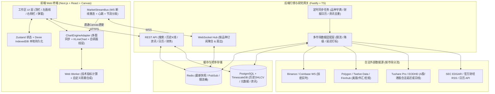
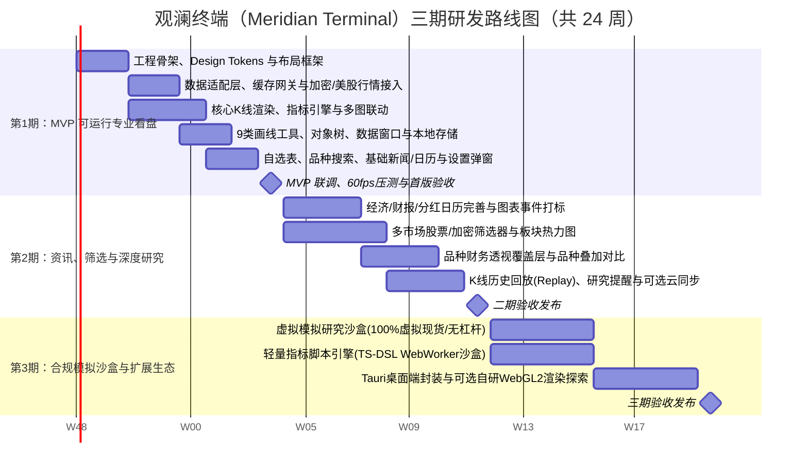

# 全球行情研究终端（观澜终端 / Meridian Terminal）第一版产品与技术规划

> **文档状态**：第一版架构与产品规划（审阅后开工，本阶段不编写应用代码）  
> **文档日期**：2026-11-26  
> **核心红线**：原创品牌与设计系统（禁用 TradingView 商标与专有素材）｜数据源 100% 合法合规且诚实标注延迟｜**面向未成年用户，仅限行情研究与虚拟模拟，严禁真实交易、严禁真实杠杆与券商对接**

---

## 目录

1. [产品定位与第一版目标（含推荐产品名）](#1-产品定位与第一版目标含推荐产品名)
2. [对标分析：对照 21 张截图拆解 TradingView 看盘体验](#2-对标分析对照-21-张截图拆解-tradingview-看盘体验)
3. [信息架构与页面地图](#3-信息架构与页面地图)
4. [全模块功能规划与 MVP 边界（做 / 不做）](#4-全模块功能规划与-mvp-边界做--不做)
5. [UI 设计规范（视觉审美、栅格布局、关键组件与 Design Tokens）](#5-ui-设计规范视觉审美栅格布局关键组件与-design-tokens)
6. [技术架构、推荐栈与仓库目录草案](#6-技术架构推荐栈与仓库目录草案)
7. [合法数据源方案（分市场、延迟、成本与合规边界）](#7-合法数据源方案分市场延迟成本与合规边界)
8. [分阶段路线图（第 1 期 / 第 2 期 / 第 3 期）](#8-分阶段路线图第-1-期--第-2-期--第-3-期)
9. [风险、合规与未成年人保护红线](#9-风险合规与未成年人保护红线)
10. [建议的下一步实现顺序（首批落地清单）](#10-建议的下一步实现顺序首批落地清单)
11. [规划完整度自评与待补充信息](#11-规划完整度自评与待补充信息)

---

## 1. 产品定位与第一版目标（含推荐产品名）

### 1.1 产品名称提案

产品需要完全原创的中英文品牌、缩写与几何视觉标识，严禁使用 TradingView 名称、Logo、商标化图标或专有字体。以下提供 3 个候选方案：

| 候选方案 | 中文名 | 英文名 | 视觉意象与调性 | 适配场景 |
|---|---|---|---|---|
| **方案 A（推荐默认）** | **观澜终端** | **Meridian Terminal** | 「观澜」取观市场波澜与趋势之意；Meridian（子午线）象征横跨全球时区与多资产市场的统一坐标体系。克制、机构级、国际化，Logo 可由原创子午弧线与极简 K 线几何构成。 | 全球多市场研究终端，兼顾中文与英文界面 |
| 方案 B | 镜纬行情 | PrismTape | 强调多维折射（技术面/基本面/宏观事件）与经典行情带（Tape），偏现代量化与科技感。 | 偏重数据筛选、多维透视与极客研究 |
| 方案 C | 枢轴研究 | PivotDeck | Pivot（关键价位枢轴）+ Deck（专业工作台），直白易记，偏图表技术分析语境。 | 偏重画线、结构分析与复盘演练 |

> **本文后续统一采用推荐默认名：「观澜终端（Meridian Terminal）」**。

### 1.2 产品定位

**观澜终端（Meridian Terminal）** 是一款 **Web 优先（后续可封装桌面端）、面向全球多资产市场的实时资讯与行情研究终端**。

- **体验定位**：在工作区布局、交互流畅度、信息密度和专业克制的审美上深度对标 TradingView 看盘工作台，让研究者获得接近专业终端的 K 线缩放、画线标注、技术指标叠加、多图联动、自选追踪与宏观资讯研究体验。
- **差异化定位**：
  1. **原生无付费墙研究体验**：原版 TradingView 基础版将多图布局（见 `multi-layout-basic-limit.png`）、多指标数量、自定义周期等核心研究能力锁在订阅墙后；观澜终端将 1/2/4 宫格多图、常用指标与画线作为免费/自托管原生能力提供。
  2. **诚实透明的数据标识**：每个品种、每条报价都明确展示数据属性（`实时` / `延迟15分钟` / `参考价 Indicative` / `收盘日线 EOD`），绝不伪造实时性。
  3. **纯粹研究与学习向**：去除社交喧嚣、促销弹窗（如截图右上角的营销按钮）与真实券商下单入口，一切空间服务于「看清价格、标注逻辑、核验数据、记录复盘」。

### 1.3 未成年人使用红线（最高优先级约束）

本项目核心使用者为未成年人，以下规则作为**架构级硬约束**写入全周期规划：

1. **绝不接入真实交易**：无券商账户 OAuth、无实盘交易 API、无真实下单/撤单/资金划转模块、图表左上角**禁止出现**类似 TradingView 的 `SELL / BUY` 快捷下单按钮。
2. **绝不提供真实杠杆与融资融券**：即使在第三期引入「模拟盘（Paper Sandbox）」，也**严格限定为 100% 虚拟本金、1 倍现货模拟（无保证金、无杠杆倍数、无强平机制、无真实衍生品撮合）**，移除 `Account margin`、`Margin buffer` 等杠杆交易字段。
3. **数据源不依赖实盘券商账户**：未成年人无法合法开立证券/期货实盘账户，因此数据源选型**严禁依赖**需要真实券商开户才能调用的行情网关（如富途 OpenD、盈透 IBKR Gateway 等），全部选用独立、合法的第三方市场数据 API。

### 1.4 第一版（MVP）核心目标

在 **8 周内** 交付一个**流畅、美观、可每日实际用于多市场看盘与画线研究**的 Web 终端：

- 打开即进入默认深色专业看盘工作区（支持一键切换浅色）；
- 覆盖 **加密现货（毫秒实时）+ 美股（合法准实时/延迟标注）+ A股/港股/外汇/大宗代理（合法延迟或日线标注）**；
- 拥有 60fps 级流畅缩放与拖拽的 K 线主图 + 成交量 + RSI/MACD/MA/EMA/BOLL/ATR 等核心技术指标；
- 支持最常用的 9 类画线标注工具（趋势线、水平线、射线、矩形、平行通道、斐波那契回撤、文字、箭头、测距尺）+ 磁铁吸附 + 对象树管理；
- 支持全球代码搜索、分组自选表、基础品种详情、1/2/4 宫格多图布局与光标联动，以及本地持久化（IndexedDB + JSON 导入导出）。

---

## 2. 对标分析：对照 21 张截图拆解 TradingView 看盘体验

通过完整审阅 `tv-ui-refs/` 目录下全部 21 张 1920×1072 截图，我们可以将 TradingView 专业看盘体验的核心竞争力归纳为**五个维度：极致画布占比、低噪音高密度排版、分层不打断的交互范式、高频操作的肌肉记忆路径、清晰的数据状态语义**。

> **主题说明**：参考截图采集于浅色模式（Light Theme），但产品规划采用**专业深色模式为主（Dark-first），浅色模式为辅**。两套主题共享完全一致的几何栅格、间距、字号层级与交互规范，仅通过语义化 Color Tokens 切换明暗对比。

### 2.1 工作区整体骨架与画布层级

- **引用截图**：`main-workspace.png`、`object-tree.png`、`data-window.png`
- **布局分区**：
  - 整个 1920×1072 视口被极细的 `1px` 分割线（而非厚重阴影卡片）切分为 5 个紧凑区域：
    1. **顶部主工具栏（约 38–40px）**：单行水平排布，左起依次为「品种搜索胶囊（`NVDA`）+ 叠加对比（`+`）｜周期（`D`）｜图表类型｜指标（`Indicators`）｜提醒｜回放｜撤销/重做」，右侧为「多图布局切换｜布局名称与保存｜快速搜索｜设置齿轮｜全屏｜截图」。
    2. **左侧画线工具栏（约 52px）**：纯图标纵向工具条，按功能语义以细横线分为 4 组（光标/线条/通道斐波那契/形态/测算/画笔图形/文字标注｜测距/缩放｜磁铁/连续画线/锁定/隐藏｜清空）。
    3. **中央核心图表区（占视口面积 >72%）**：由主图区（K线 + 底部贴底成交量柱 + 公司事件圆标 `D` 分红/`E` 财报/闪电资讯）与下方可拖拽高度的副图面板（如 `RSI 14`、`MACD 12 26 9`）垂直堆叠；右侧共享对齐的价格坐标轴（约 68–76px），底部为时间轴 + 快捷时间跨度条（`1D 5D 1M 3M 6M YTD 1Y 5Y All` + 跳转日期）+ 时区时钟（`UTC+8`）与 `ADJ`/`LOG`/`AUTO` 坐标开关。
    4. **右侧可折叠功能抽屉（约 290–320px）**：默认上下分栏——上半为「自选表」，下半为「当前品种详情卡片」，中间带可拖拽分隔条；切换至「对象树/数据窗口」时整栏显示。
    5. **最右侧极窄图标导航轨（约 44px）**：独立垂直停靠，用于一键开关自选、提醒、对象树、日历、新闻流、筛选器等右侧面板。
    6. **底部可折叠停靠栏（折叠态约 32px，展开态约 260–300px）**：贴合主图底部，不影响右侧栏全高展示。
- **信息密度与配色**：
  - 视觉权重严格服从「价格 > 标注/指标 > 坐标标签 > 工具栏chrome」：网格线极淡（低透明度虚线），价格轴上的当前价标签（红底白字 `141.71` 并内嵌当根 K 线收盘倒计时 `04:42:34`）和关键画线价格标签（蓝底 `243.37`、`183.94`）形成高对比锚点。
  - 图表左上角图例行（Status Line）极其紧凑：一行集成「资产图标 + 全称 + 周期 + 交易所 + 绿点 `Open` + 粉紫胶囊 `Indicative data` + OHLC 涨跌色数值」，不占主图高度。
- **必须学到的交互与我们的取舍**：
  - **学习**：所有数值强制等宽数字（`tabular-nums`），跳动时不抖动；副图与主图共用 X 轴且分隔线可直接拖拽调高；K 线倒计时直接嵌入最新价坐标胶囊；鼠标悬停图例行才显示隐藏/设置/删除小图标，平时零干扰。
  - **取舍**：**彻底移除**主图左上角的 `SELL / BUY` 买卖快捷按钮、顶栏的 `Trade` 券商下拉和 `Black Friday` 营销按钮，把空间还给研究状态提示与快捷操作。

### 2.2 画线工具栏、对象树与数据窗口

- **引用截图**：`drawing-toolbar.png`、`object-tree.png`、`data-window.png`
- **布局与交互**：
  - **分组抽屉弹出（`drawing-toolbar.png`）**：左侧 52px 工具栏的每个主按钮代表一类工具，点击右侧微箭头展开悬浮二级菜单（如几何图形组内再细分为 `BRUSHES`、`ARROWS`、`SHAPES`），菜单内直接标注快捷键（如 `Rectangle  Alt + Shift + R`）。磁铁按钮激活时以高对比反色胶囊高亮（图中深黑底白图标），状态一目了然。
  - **复杂标注承载力（`main-workspace.png`）**：截图中同时叠加了下降趋势线、斐波那契回撤色带（0 / 0.236 / 0.382 / 0.5 / 0.618 / 0.786 / 1 附带实时价位）、半透明紫框阻力区、蓝字中文事件复盘注释，画面依然清晰可读——关键在于**填充色极低透明度（8%–15%）+ 细实线边框 + 标签自动避让**。
  - **对象树（`object-tree.png`）**：与「数据窗口」通过右侧栏顶部 Segmented Toggle 切换，按主图/副图分层列出所有指标与画线对象（`Vol`、`Text`、`Fib retracement`、`Trendline`、`Rectangle`、`Horizontal line`、`RSI`、`MACD`），支持顶部批量新建文件夹、编组、排序、显隐与锁定。
  - **数据窗口（`data-window.png`）**：随十字光标移动实时刷新当前 K 线的日期、`Open / High / Low / Close / Change / Vol / Last day change` 以及所有指标精确读数（如 RSI 与 RSI-based MA、MACD 柱/快线/慢线），并沿用各曲线自身颜色编码，极大方便精准读数与复盘。

### 2.3 周期切换、图表类型与指标弹窗

- **引用截图**：`timeframe-bar.png`、`chart-type-menu.png`、`indicator-dialog.png`
- **周期选择器（`timeframe-bar.png`）**：
  - 下拉面板顶置 `+ Add custom interval...`，下方按 `TICKS / SECONDS / MINUTES / HOURS / DAYS` 折叠分组；选中态采用深色圆角整行高亮（`1 day`）。高频周期支持「加星固定」到顶栏横向快捷切换（如 `5m 15m 1h 4h 1D 1W`），减少二级菜单点击。
- **图表类型菜单（`chart-type-menu.png`）**：
  - 图标 + 文字单列菜单，用细横线自然分隔为 5 组：传统柱/K 线（`Bars`、`Candles`、`Hollow candles`、`Volume candles`）、折线系（`Line`、`Line with markers`、`Step line`）、面积系（`Area`、`HLC area`、`Baseline`）、成交/分布系、非时间轴系（`Heikin Ashi`、`Renko`、`Kagi`、`Range` 等）。空心 K 线（`Hollow candles`）在截图中表现为阳线空心绿框、阴线实心红柱，视觉通透度极佳，必须纳入 MVP。
- **指标弹窗（`indicator-dialog.png`）**：
  - 居中模态框（约 720px 宽），顶部全宽搜索框（打开自动聚焦），下方左窄右宽两栏：左侧为来源分类（`Personal` / `Built-in` 含 `Technicals` & `Fundamentals` / `Community`），右侧顶部带圆角胶囊类型筛选（`Indicators` / `Strategies` / `Profiles` / `Patterns` / `Options`），列表点击即瞬时叠加到图表且支持连续添加不强制关闭弹窗。

### 2.4 品种搜索、分组自选表与品种详情/财务透视

- **引用截图**：`symbol-search.png`、`watchlist.png`、`right-sidebar.png`、`main-workspace.png`
- **全局品种搜索（`symbol-search.png`）**：
  - 居中大搜索框支持「代码 / 名称 / ISIN / CUSIP」，下方一排资产大类胶囊（`All / Stocks / Funds / Futures / Forex / Crypto / Indices / Bonds / Economy / Options`）。
  - 列表行高紧凑（约 44px），左端圆形资产徽标 + 粗体代码 + 描述 + 微型资产标签（`STOCK`、`FUTURES`、`FUND ETF`、`SPOT CRYPTO`、`COMMODITY CFD`），右端展示交易所名称与同品种多源折叠标识（如 `NASDAQ +31`）。
  - **关键肌肉记忆**：在图表任意空白处**直接键盘敲击字母/数字**即自动唤起搜索框并带入首字符，回车立即切换品种。
- **分组自选表（`watchlist.png`）**：
  - 支持多自选清单切换（顶部 `自选表 v` + `+` 添加 + 分组管理），列表内用可折叠小标题分区（如 `指数`、`股票`、`期货`、`外汇`、`加密货币`）。
  - 四列极简排版：`Symbol`（左对齐）、`Last`、`Chg`、`Chg%`（均右对齐 + 等宽数字）。**特别值得学习的是状态微标**：中国指数/A股/港股代码旁带黄色 `D`（Delayed 延迟标识）与灰/绿圆点（休市/开盘），外汇与期货报价末端小数位以更小字号或变色闪烁体现跳动（如 `1.0947⁸`）。选中行用圆角外框清晰标注（如 `NVDA`）。
- **右侧品种详情与全屏财务叠加层（`main-workspace.png`、`right-sidebar.png`）**：
  - 右侧下半区在 300px 窄栏内塞入了极高价值的模块流：大号现价与涨跌幅、开休市圆点、当日成交量 vs 30日均量进度条、`Key facts` 摘要卡片、`Key stats` 键值表、迷你利润表柱折组合图（支持 `Annual / Quarterly` 切换）、6 格阶段涨跌幅热力块（`1W / 1M / 3M / 6M / YTD / 1Y`）、季节性走势、技术面指针仪。
  - 点击 `More financials` 后（`right-sidebar.png`），**不会跳转新页面丢失自选表**，而是在主图区域上方展开全宽「品种财务叠加层（Overlay）」，顶部带二级胶囊导航（`Overview / Statements / Statistics / Estimates / Dividends / Earnings / Segments`），内含核心指标网格、股权结构环形图、资本结构瀑布图、P/E & P/S 历史估值折线图。这种「保留右侧自选轨、左区平滑切换深度研究视图」的模式极其高效，应在二期复刻。

### 2.5 资讯流、经济日历与股票筛选器（不离盘面研究）

- **引用截图**：`news-flow.png`、`news-or-calendar.png`、`market-overview-or-screener.png`
- **共同交互范式**：三者都以**右侧宽抽屉（约占 45%–52% 视口宽度，可拖拽调宽或全屏展开）**的形式与左侧实时 K 线并排展示——研究者可以一边看日历事件或突发新闻，一边即时观察 K 线反应，无需切标签页。
- **经济日历（`news-or-calendar.png`）**：
  - 顶部周切换器 + `Today` 快捷按钮 + 7 天横向卡片带（每日直接汇总 `Economic / Earnings / Dividends / IPO` 数量，当天加粗下划线）；下方 4 类胶囊页签 + 重要性柱状过滤 + 国家/分类过滤；主表按日期分组，每行包含「时间（临近事件红底高亮）+ 国旗 + 3 格波动重要性条 + 事件名 + 倒计时（`Coming in 08:35`）+ `Actual / Forecast / Prior` 三列对比」。
- **新闻流（`news-flow.png`）**：
  - 顶部带快捷过滤胶囊：`Watchlist`、`Same as chart`（联动当前主图品种，默认极高频实用！）、`+ Add filter`。条目采用轻量化时间轴样式：「关联品种小图标 + 相对时间 + 媒体来源（Reuters / MarketWatch 等）+ 加粗标题」，信息密度极高，无大图占位浪费。
- **股票筛选器（`market-overview-or-screener.png`）**：
  - 顶部两层筛选结构：第一排为场景预设胶囊（`All stocks`、`Most capitalized`、`Highest net income` 等）；第二排为多条件组合下拉筛选胶囊（市场、自选、指数、价格、涨跌幅、市值、P/E、股息率、行业、ROE、Beta 等），支持 `+` 动态添加字段。
  - 下方为高密度虚拟滚动数据表，支持 `Table` 视图与 `Overview / Valuation / Performance` 列集切换，点击任意行左侧图表立即联动切换至该品种！

### 2.6 多图布局与图表精细化设置

- **引用截图**：`multi-layout.png`、`multi-layout-picker.png`、`multi-layout-basic-limit.png`、`chart-settings.png`、`chart-settings-symbol.png`、`chart-settings-scales.png`、`chart-settings-canvas.png`
- **多图布局选择器（`multi-layout.png`、`multi-layout-basic-limit.png`）**：
  - 顶栏弹出矩阵网格，按窗格数 `1 ~ 16` 分行呈现所有切分拓扑（左右双图、上下双图、1大2小、2×2 四宫格等）。
  - 底部 `SYNC IN LAYOUT` 区域提供 5 个独立的联动开关：`Symbol`（同品种不同周期）、`Interval`（同周期不同品种）、`Crosshair`（十字光标联动，默认开启）、`Time`（时间点对齐）、`Date range`（缩放区间同步）。
  - `multi-layout-basic-limit.png` 清晰暴露了 TradingView 的商业化卡点（基础版限制单图）。观澜终端在 MVP 直接原生开放 **1 / 2H / 2V / 4 宫格 + 光标/品种/周期联动**，消除学习者的核心痛点。
- **图表设置弹窗（`chart-settings*.png`）**：
  - 750×560 左右居中弹窗，左栏分组导航（`Symbol`、`Status line`、`Scales and lines`、`Canvas`、`Events` 等；我们**不设**真实 `Trading` 选项卡），右栏分区表单，左下角带 `Template` 样式模板存取，右下角 `Cancel / Ok`。
  - 必须吸收的关键专业配置项：
    - `Symbol`（`chart-settings-symbol.png`）：涨跌实体/边框/影线独立配色、分红复权开关（`Adjust data for dividends`）、价格精度、时区选择（默认本地如 `UTC+8 Shanghai`）。
    - `Scales and lines`（`chart-settings-scales.png`）：防标签重叠（`No overlapping labels`）、K 线收盘倒计时（`Countdown to bar close`）、盘前/盘后/夜盘参考线、最高最低价线、时间轴日期格式与星期显示。
    - `Canvas`（`chart-settings-canvas.png`）：背景色/渐变、横纵网格线显隐与透明度、副图分隔线、十字光标线型、水印开关、画布上下留白比例（默认 `Top 10%`、`Bottom 8%`）与右侧留白柱数（默认 `Right 10 bars`）——这个留白细节直接决定了画线与看未来空间的手感。

### 2.7 底部停靠面板（合规重构）

- **引用截图**：`bottom-panel.png`、`main-workspace.png`
- **观察与合规重构**：
  - 截图中底部面板用于 `Paper Trading`，折叠时仅占 32px，展开后顶部展示账户摘要条，下方用胶囊切页展示持仓、委托、历史、资金曲线、分析等。
  - **观澜终端的演进策略**：
    - **第 1 期（MVP）**：底部停靠栏承接 **「研究笔记 / 复盘日志（与当前品种及画线绑定）」+「快捷品种对比表」**，默认折叠以最大化图表高度。
    - **第 3 期（模拟研究沙盒）**：在此底部停靠栏增加「虚拟模拟研究（Paper Sandbox）」标签页，但**硬编码禁用保证金/杠杆字段**，仅保留「虚拟总资产、可用虚拟现金、持仓市值、虚拟浮盈/已实现盈亏、净值曲线、复盘交易日志」，并常驻「仅研究模拟 · 虚拟资金 · 无杠杆」合规徽标。

---

## 3. 信息架构与页面地图

### 3.1 总体信息架构（IA）

观澜终端以 **「单页沉浸式看盘工作区（`/chart`）」为核心枢纽**，辅以可侧滑展开的「不离盘面研究抽屉」和独立路由的「深度全景页」，确保 80% 的日常操作无需离开图表上下文。

```text
观澜终端（Meridian Terminal）
├── /chart (默认入口：主看盘工作区，支持 /chart/:symbol 直达)
│   ├── 顶栏工作台控制（品种搜索、对比、周期、图型、指标、多图布局、模板、设置、主题）
│   ├── 左侧画线工具轨（分组抽屉 + 磁铁/锁定/隐藏 + 常用悬浮收藏条）
│   ├── 中央多图画布（1/2/4 宫格；每格含主图+成交量+事件标+可调副图+底部时间跨度条）
│   ├── 右侧可切换抽屉（由最右 44px 图标轨驱动）
│   │   ├── 自选表 + 品种详情分栏（默认展开）
│   │   ├── 对象树 / 数据窗口（Segmented 切换）
│   │   ├── 实时新闻流（宽抽屉，默认联动当前品种）
│   │   ├── 经济与财报日历（宽抽屉）
│   │   ├── 市场筛选器快捷抽屉（宽抽屉，点击行同步主图）
│   │   └── 价格条件提醒面板（二期，纯研究提醒）
│   ├── 主图内覆盖层（不遮挡右侧自选轨）
│   │   └── 品种基本面与财务透视 Overlay（二期）
│   └── 底部可折叠停靠栏
│       ├── 品种研究笔记 / 复盘日志（MVP）
│       ├── 轻量指标脚本编辑器（三期）
│       └── 虚拟模拟研究沙盒（三期，100% 虚拟现货、无杠杆）
├── /markets（二期：全球市场总览——板块热力图、全球指数矩阵、涨跌幅榜、宏观看板）
├── /screener（二期：全屏多市场筛选器——美股/加密/港A股分 tab、自定义条件组合）
├── /calendar（二期：全屏宏观经济、财报与除权日历）
├── /news（二期：全屏全球财经资讯聚合与主题筛选）
└── /settings（全局偏好设置、快捷键总览、数据源状态与延迟说明、本地数据导入/导出、合规声明）
```

### 3.2 关键页面路由规范

| 路由路径 | 页面定位 | 阶段 | 核心特征 |
|---|---|---|---|
| `/chart` | 默认看盘工作区 | **MVP** | 加载上次保存的本地布局与默认品种（如 `NASDAQ:NVDA` 或 `BINANCE:BTCUSDT`） |
| `/chart/[exchange]/[symbol]` | 指定品种直达看盘 | **MVP** | 支持 URL 参数 `?interval=1D&layout=2h`，便于书签与复盘笔记链接回跳 |
| `/markets` | 全球市场总览与热力图 | 第 2 期 | 指数行情条、行业板块热力图、涨跌榜、大宗/外汇/加密速览 |
| `/screener` | 全屏多市场筛选器 | 第 2 期 | 完整条件构造器 + 虚拟滚动表格，支持一键打开至 `/chart` |
| `/calendar` | 宏观经济与财报日历 | 第 2 期 | 全屏周/日视图、重要性/国家/品种过滤 |
| `/news` | 全球财经资讯流 | 第 2 期 | 按市场、自选、情绪/主题聚合，外链原文阅读 |
| `/settings` | 系统与数据源配置中心 | **MVP** | 主题、快捷键、API Key 本地/服务端状态监控、数据延迟透明声明、备份恢复 |

---

## 4. 全模块功能规划与 MVP 边界（做 / 不做）

以下按「研究行情」优先级组织 10 大功能域，明确对应 TradingView 模块、核心交互、MVP/二期/三期归属与技术实现要点。

### 4.1 功能矩阵总览

| # | 功能域 | 对照 TradingView 模块 | 核心交互要点 | MVP（第1期） | 第 2 期 | 第 3 期 | 技术实现要点 |
|---|---|---|---|---|---|---|---|
| 1 | **图表工作区** | 主图+副图+顶栏+底轴（`main-workspace.png`, `timeframe-bar.png`, `chart-type-menu.png`, `multi-layout.png`） | 滚轮缩放/拖拽平移、十字光标、价格轴纵向拉伸、双击重置、1/2/4 宫格联动光标、K线收盘倒计时、坐标切换（普通/对数/自动） | K线/空心K/美国线/折线/面积/成交量；周期 1m~1M + 自定义；对数/普通/自动；复权切换（美股/A股支持市场）；1/2H/2V/4宫格 + 光标/品种/周期联动 | 基线图/Heikin Ashi；品种叠加对比（Compare `%`）；K 线回放（Bar Replay）用于历史复盘；时间区间同步 | 最多 8 宫格；盘前盘后阴影区与分时扩展视图 | Canvas 2D 高频渲染（`KLineChart` 引擎封装 + 自研适配器），tick 直通 Canvas 绕过 React 渲染；DPR 清晰度适配 |
| 2 | **画线与标注** | 左侧画线栏 + 对象树（`drawing-toolbar.png`, `object-tree.png`） | 点选拖拽绘制、端点头微调、选中弹出悬浮样式条（色/线宽/虚实/文字）、强弱磁铁吸附 OHLC、隐藏/锁定、Undo/Redo、对象树分层管理 | **核心 9 件套**：趋势线、水平线、射线、平行通道、矩形、斐波那契回撤、文字标注、箭头、测距尺；磁铁吸附；锁定/显隐；基础对象树；本地按品种持久化 | 扩展图形（圆/椭圆/三角形/折线/画笔/高亮/多空盈亏比测算尺）；画线模板保存；对象树编组与跨周期可见性控制 | 画线云同步；标注快照导出高清图（带原创水印） | 基于世界坐标 `(timestamp, price)` 存储而非屏幕像素，确保缩放/切换对数坐标/跨周期时精确锚定；命中检测（Hit-testing）走独立 Canvas Overlay |
| 3 | **技术指标** | 指标弹窗 + 图例参数（`indicator-dialog.png`, `data-window.png`） | 搜索即加、主图叠加/自动新建副图、悬停图例打开参数与样式弹窗、数据窗口实时同步各指标值 | **核心 7+1 指标**：SMA(MA)、EMA、布林带(BOLL)、成交量(VOL)、RSI(含MA)、MACD、ATR、VWAP（有日内成交量市场）；参数面板；数据窗口 | 扩展指标库（KDJ、Stoch RSI、ADX、OBV、Ichimoku、枢轴点、EMA Ribbon）；指标模板保存；副图指标叠加到另一指标 | 开放轻量指标脚本引擎，允许用户自定义指标并在弹窗 `My Scripts` 中加载 | 纯 TypeScript 指标计算库运行于 **Web Worker**，避免长历史序列计算卡顿主线程；支持增量 bar 追加更新（O(1) 级滚动更新） |
| 4 | **品种搜索与自选** | 搜索弹窗 + 自选栏（`symbol-search.png`, `watchlist.png`） | 图表任意处键入即搜、市场胶囊过滤、回车切图；自选多分组折叠、拖拽排序、行内红绿闪烁、延迟徽标 `D` 与开休市状态 | 全局代码/中英文名搜索（按市场分类）；多自选表 + 折叠分组；涨跌额/涨跌幅/延迟标识；快捷右键加入自选 | 自选列表迷你走势图（Sparkline）、自定义列（成交量/市值/P/E）、色标旗帜分类、自选导入导出 CSV | 多设备云端同步自选与分组 | 后端统一维护标准化品种主表（Meilisearch 或 Postgres `pg_trgm` 模糊检索 <30ms）；前端用 `TanStack Virtual` 支撑千级自选零卡顿 |
| 5 | **行情资讯与日历** | 新闻流 + 经济日历（`news-flow.png`, `news-or-calendar.png`） | 右侧宽抽屉与主图并排查看；新闻支持 `联动当前品种 / 自选 / 全市场`；日历周卡片切换、重要性过滤与倒计时 | 基础品种新闻流抽屉（美股/加密合法资讯源，展示标题/时间/来源并外链原文）；基础宏观经济日历（周视图 + 重要事件） | 财报日历、除权分红日历、图表底轴事件圆标（`E` 财报 / `D` 分红）；A/港股公告摘要（合法来源）；关键词与媒体过滤 | 重大宏观事件自动在 K 线时间轴打标；AI 摘要辅助（可选，严守不给投资建议红线） | 服务端定时抓取合法 API + 官方 RSS 聚合，去重并做品种代码映射（Entity Linking），Redis 缓存，严禁抓取付费墙全文 |
| 6 | **市场总览与筛选器** | 股票筛选器（`market-overview-or-screener.png`） | 预设策略胶囊 + 多条件筛选条 + 排序表，点击行联动主图 | **MVP 仅做轻量化「全球核心指数/涨跌速览条」**（放在自选预设分组或轻量抽屉），**不做**重型全市场筛选器与热力图 | **完整落地**：股票/加密多维筛选器（侧滑抽屉 + 全屏页）、板块热力图（Treemap）、涨跌幅/成交额榜 | 自定义筛选方案保存、定时快照对比、跨市场相关性矩阵 | 后端定时同步日频/准实时快照入 PostgreSQL/ClickHouse，筛选查询走索引分页（<150ms），前端 ECharts/D3 渲染热力图 |
| 7 | **品种详情与基本面** | 右侧详情区 + 财务覆盖层（`main-workspace.png`, `right-sidebar.png`） | 自选区下方实时跟随选中品种，展示核心报价、量能对比、关键统计；点击展开详细财务覆盖层 | 右侧分栏展示：报价头、市场状态与延迟说明、今开/昨收/高低/52周区间、成交量对比、基础公司简况、阶段涨跌幅热力块（1W~1Y） | 完整「财务透视 Overlay」：核心指标、三大报表（年度/季度）、估值趋势图（P/E、P/S）、股本结构与分红记录（美股优先，A/港股按合法源覆盖） | 同行业估值对比卡片、财报电话会/SEC EDGAR 原始文件直达索引 | 财务数据低频变动，服务端按季度/每日同步至 Postgres 并做长期缓存，前端异步按需加载 |
| 8 | **模拟盘（Paper Sandbox）** | 底部面板（`bottom-panel.png`） | 仅在研究场景下用虚拟资金验证交易思路与仓位管理，记录复盘笔记 | **不做**（MVP 底部栏仅提供「品种研究笔记/复盘日志」） | **不做**（二期专注资讯、筛选与多图深度研究） | **三期合规上线**：100% 虚拟本金、**严格 1x 现货（禁杠杆/禁融资/禁保证金/禁实盘）**、市价/限价模拟记录、持仓/历史/虚拟净值曲线、强制复盘理由填写 | 独立撮合模拟器仅基于延迟/实时行情快照在本地或自托管库记账，架构层物理隔离任何真实支付与券商网关 |
| 9 | **脚本与策略（指标扩展）** | 指标弹窗 `My Scripts`（`indicator-dialog.png`） | 允许进阶学习者编写自定义指标公式并实时叠加到图表 | **不做脚本 IDE，也不做 Pine 兼容**；但底层指标引擎预留标准化插件接口 | 开放内置 JSON 参数化组合指标（如自定义多均线组、自定义告警条件） | **三期上线轻量 TypeScript/DSL 指标沙盒**（基于 Web Worker + AST 白名单沙盒，支持常见向量序列函数 `sma/ema/rsi/crossover`） | **为何首期不做 100% Pine 兼容**：Pine Script 拥有十余年积累的数百个内置状态函数、历史引用语义、重绘控制与安全/数组/绘图库，完整兼容投入超 6–12 人月且易陷入语法专利/商标纠纷。采用类 TS 轻量化向量 DSL 更安全、性能更高、学习价值更大 |
| 10 | **账户、设置与布局保存** | 设置弹窗（`chart-settings*.png`） | 深/浅色一键切换、图表外观精细配置、画布留白、时区、快捷键表、工作区布局命名与保存 | **免登录本地优先**：IndexedDB + LocalStorage 自动保存多套布局、画线、自选与图表偏好；支持一键导出/导入完整 JSON 备份；深色默认 + 浅色切换；完整快捷键映射 | 可选轻量自托管账户（邮箱/Passkey 登录，无实名金融信息采集），实现多端云同步布局、画线与自选；样式模板保存 | 分享只读研究快照链接（脱敏图表+标注，方便学习讨论） | 配置全部通过版本号管理的 Schema 序列化（`zod` 校验），支持向前迁移，断网亦可离线查看本地缓存与画线 |

### 4.2 MVP「做 / 不做」清晰边界清单

#### ✅ MVP（第 1 期）明确要做
1. **专业级单页看盘工作区**：完整复刻 5 区高密度框架（顶栏、左画线栏、多窗格主画布、右侧自选+详情/对象树/数据窗口、底部折叠研究笔记栏）。
2. **核心行情渲染**：K 线、空心 K 线、美国线、折线、面积图、底部成交量；周期 `1m / 5m / 15m / 30m / 1h / 4h / 1D / 1W / 1M` + 自定义周期；普通/对数/自动坐标；前复权/不复权（支持市场）；K 线倒计时与十字光标。
3. **1 / 2H / 2V / 4 宫格多图布局**：支持十字光标联动、品种联动、周期联动。
4. **核心 9 类画线工具 + 对象树 + 磁铁吸附**：趋势线、水平线、射线、平行通道、矩形、斐波那契回撤、文字、箭头、测距尺，支持 Undo/Redo、显隐、锁定与本地持久化。
5. **核心 8 个内置技术指标 + 参数弹窗 + 数据窗口**：SMA、EMA、BOLL、VOL、RSI、MACD、ATR、VWAP。
6. **全球代码搜索 + 分组自选表 + 基础品种详情**：包含透明的数据延迟与开休市状态徽标。
7. **基础资讯流与基础经济日历抽屉**：合法 API 接入，与主图并排不跳转。
8. **完整图表设置弹窗 + 主题切换（深色为主/浅色可选）+ 快捷键 + 本地 JSON 备份恢复**。

#### ❌ MVP（第 1 期）明确不做
1. **不做** 真实交易、券商对接、下单按钮、真实杠杆/融资融券（**全周期永久禁止**）。
2. **不做** TradingView 行情/私有接口爬虫（**全周期永久禁止**）。
3. **不做** 100% Pine Script 语法兼容与社区脚本市场。
4. **不做** 重型全市场股票筛选器、行业热力图与完整三大财务报表覆盖层（移至第 2 期）。
5. **不做** K 线历史回放（Bar Replay）与价格告警推送（移至第 2 期）。
6. **不做** 虚拟模拟盘（Paper Sandbox）（移至第 3 期）。
7. **不做** 复杂社交评论区、聊天室、付费订阅系统与移动端原生 App（MVP 专注桌面宽屏 Web，适配 `>=1280px` 主流显示器）。

---

## 5. UI 设计规范（视觉审美、栅格布局、关键组件与 Design Tokens）

### 5.1 视觉审美原则（原创专业金融风格）

- **克制、精准、低视觉疲劳**：以深石板炭灰（而非纯黑 `#000000`）作为画布底色，降低长时间盯盘的眩光；所有面板边界使用 `1px` 低对比度发丝线（Hairline）切割，避免卡片套卡片导致的视觉臃肿。
- **色彩严格服务于数据语义**：界面 chrome 保持中性冷灰，仅将饱和色留给涨跌方向、活动指标曲线、用户画线标注以及关键状态徽标（开盘绿、延迟琥珀、实时青蓝）。
- **涨跌配色习惯可切换**：默认提供「国际惯例（绿涨红跌）」并支持设置中一键切换为「A股习惯（红涨绿跌）」，全站 K 线、自选表、涨跌徽标同步联动。
- **100% 原创视觉资产**：
  - 图标：基于开源 **Lucide Icons**（ISC 协议）+ 自绘极简 `1.5px` 描边金融几何 SVG（趋势线、斐波那契、空心K、磁铁、多图网格等），零借用 TradingView 图标文件。
  - 字体：全部使用开源无版权风险字体——西文 UI 用 `Inter`，中文回退 `Noto Sans SC` / 系统 `PingFang SC`，所有价格与时间轴数字启用 `font-variant-numeric: tabular-nums`（可选 `JetBrains Mono` 用于代码与数据窗口）。

### 5.2 工作区布局栅格（基于 1920×1080 标准桌面视口）

```text
+---------------------------------------------------------------------------------------------+
| TopBar (h: 40px)  [Logo][NVDA 🔍][+][1D v][Candles][Indicators][Layout][Settings][Theme]     |
+----+------------------------------------------------------------------+----------------+----+
| L  | Chart Status Line (Overlay: Symbol · 1D · Status · Delay · OHLC) | Watchlist      | R  |
| e  |                                                                  | Header (36px)  | i  |
| f  |                                                                  |----------------| g  |
| t  |                    Main Candlestick + Volume Pane                | Grouped Rows   | h  |
|    |                      (Resizable Height ~62%)                     | (Virtual List) | t  |
| T  |                                                                  |  Symbol Last % |    |
| o  |------------------------------------------------------------------|================| R  |
| o  | RSI (14) Sub-pane (~19%)                                         | Symbol Details | a  |
| l  |------------------------------------------------------------------| (Resizable     | i  |
| s  | MACD (12, 26, 9) Sub-pane (~19%)                                 |  Bottom Split) | l  |
| 48 |------------------------------------------------------------------|  Price / Stats | 44 |
| px | Time Axis (26px) + Quick Range Bar (1D..All | UTC+8 | LOG | ADJ) |  Perf Tiles    | px |
|    +------------------------------------------------------------------+                |    |
|    | Bottom Dock (Collapsed: 32px | Expanded: 260px — Notes / Sandbox)|                |    |
+----+------------------------------------------------------------------+----------------+----+
  48px                     Fluid Canvas (>= 65% width)                     288~340px      44px
```

- **宽抽屉模式（新闻流 / 日历 / 筛选器）**：右侧抽屉宽度自动平滑扩展至 `520px ~ 48vw`（支持鼠标左缘拖拽调宽，或点击右上角最大化图标铺满工作区）。
- **断点降级策略**：
  - `>= 1440px`：完整 5 区展开，右侧栏默认 `312px`。
  - `1280px ~ 1439px`：右侧栏收窄至 `272px`，顶栏次要按钮折叠进 `...` 菜单。
  - `< 1280px`：右侧栏默认收起为悬浮抽屉，优先保证主图可用宽度。

### 5.3 核心 Design Tokens（原创设计系统）

以下 Token 采用 CSS Custom Properties 定义，实现零闪烁暗/亮主题切换：

```css
/* ===== Meridian Terminal Design Tokens (v1) ===== */
:root,
[data-theme="dark"] {
  /* 1. 背景层级 Surface Hierarchy (深石板冷灰系，拒绝纯黑) */
  --bg-canvas:        #0E1117;   /* 主图画布底色 */
  --bg-panel:         #131722;   /* 顶栏、侧栏、底栏背景 */
  --bg-elevated:      #1B2130;   /* 悬浮菜单、弹窗、下拉面板 */
  --bg-hover:         #232B3E;   /* 控件悬停态 */
  --bg-active:        #2B364F;   /* 控件激活/选中态 */
  --bg-input:         #0B0E14;   /* 输入框底色 */

  /* 2. 分割线与网格 Borders & Grid */
  --border-hairline:  #222938;   /* 工作区 1px 区域分割线 */
  --border-subtle:    #2D364A;   /* 按钮、输入框边框 */
  --border-focus:     #3B82F6;   /* 聚焦环 */
  --chart-grid:       rgba(148, 163, 184, 0.08); /* 极淡画布网格 */
  --chart-crosshair:  rgba(148, 163, 184, 0.45); /* 十字光标虚线 */

  /* 3. 文字层级 Typography Colors */
  --text-primary:     #E6EDF7;   /* 主标题、现价、主要代码 */
  --text-secondary:   #9AA6BC;   /* 坐标轴刻度、副标题、表头 */
  --text-muted:       #66738A;   /* 辅助说明、占位符、休市文字 */
  --text-inverse:     #0B0E14;   /* 亮色徽标反色文字 */

  /* 4. 品牌强调色 Brand Accent (子午钴蓝) */
  --accent-primary:   #3B82F6;   /* 主交互高亮、选中边框 */
  --accent-hover:     #2563EB;
  --accent-soft:      rgba(59, 130, 246, 0.14);

  /* 5. 行情语义色 Market Semantics (国际绿涨红跌；A股模式通过 data-color-scheme="cn" 互换) */
  --market-up:        #16B981;   /* 涨：翡翠青绿 */
  --market-up-soft:   rgba(22, 185, 129, 0.16);
  --market-down:      #F2485B;   /* 跌：珊瑚亮红 */
  --market-down-soft: rgba(242, 72, 91, 0.16);

  /* 6. 数据状态语义色 Data Provenance Badges */
  --status-live:      #10B981;   /* 实时 WebSocket */
  --status-delayed:   #F59E0B;   /* 延迟数据 D 徽标 */
  --status-indicative:#A855F7;   /* 参考报价 Indicative */
  --status-eod:       #64748B;   /* 日线收盘 EOD */

  /* 7. 指标默认色板 Indicator Palette (深底高辨识) */
  --ind-line-1:       #38BDF8;   /* MA5 / MACD Fast */
  --ind-line-2:       #FBBF24;   /* MA20 / Signal / RSI-MA */
  --ind-line-3:       #C084FC;   /* RSI / MA60 */
  --ind-line-4:       #FB7185;   /* BOLL Band / MA120 */
}

[data-theme="light"] {
  --bg-canvas:        #FFFFFF;
  --bg-panel:         #F7F9FC;
  --bg-elevated:      #FFFFFF;
  --bg-hover:         #EDF1F7;
  --bg-active:        #E2E8F2;
  --bg-input:         #F1F4F9;
  --border-hairline:  #E2E7F0;
  --border-subtle:    #CFD7E4;
  --chart-grid:       rgba(15, 23, 42, 0.06);
  --chart-crosshair:  rgba(15, 23, 42, 0.40);
  --text-primary:     #111827;
  --text-secondary:   #4B5563;
  --text-muted:       #8A94A6;
  --text-inverse:     #FFFFFF;
  --market-up:        #0D9668;
  --market-down:      #E03146;
}
```

#### 字号、间距、圆角与 Z-Index 层级规范

| 维度 | Token / 档位 | 具体数值 | 使用场景 |
|---|---|---|---|
| **字号** | `xs / sm / base / md / lg / price-xl` | `11px / 12px / 13px / 14px / 16px / 24px` | 坐标轴刻度与徽标 `11px`；自选行/菜单/状态行 `12–13px`；弹窗标题 `16px`；详情大报价 `24px` |
| **字体族** | `--font-sans` / `--font-mono` | `Inter, "Noto Sans SC", sans-serif` / `"JetBrains Mono", monospace` | 所有价格、涨跌幅、成交量、坐标轴强制 `font-variant-numeric: tabular-nums` |
| **间距** | 4px 基数体系 | `2 / 4 / 6 / 8 / 12 / 16 / 20 / 24px` | 极紧凑控件内边距 `4–6px`，模块留白 `12–16px`，弹窗内边距 `20px` |
| **圆角** | `xs / sm / md / lg / full` | `3px / 4px / 6px / 10px / 9999px` | 价格坐标胶囊 `3px`，工具栏按钮 `4px`，下拉/弹窗 `8–10px`，市场筛选标签 `full` |
| **Z-Index** | 分层防遮挡体系 | `canvas: 1` → `chart-overlay: 10` → `floating-toolbar: 20` → `dock-panels: 30` → `dropdown/flyout: 40` → `modal-backdrop: 50` → `modal: 60` → `toast/tooltip: 70` | 保证画线悬浮属性条不遮挡弹窗，搜索框与设置弹窗始终居顶 |

### 5.4 关键组件交互细则

1. **图例状态行（Chart Legend）**：始终贴主图左上角，显示资产徽标、代码、周期、交易所、开休市圆点、**不可隐藏的数据来源与延迟胶囊（如 `延迟15分钟` / `实时` / `EOD`）**、实时 OHLC 与涨跌幅；下排显示成交量及主图叠加指标，悬停单条指标时浮现「隐藏 / 参数设置 / 删除」三按钮。
2. **画线悬浮样式条（Floating Drawing Bar）**：点击画布上任意已绘图形后，在其上方出现可拖拽半透明工具条，提供「线条色 / 填充色 / 线宽 / 线型 / 文字编辑 / 锁定 / 置于顶层 / 删除」，无需进入二级弹窗即可高频调参。
3. **全局快捷键体系（对标肌肉记忆）**：
   - 任意字母/数字：打开品种搜索；
   - `/`：打开指标搜索；
   - `Alt + T` 趋势线、`Alt + H` 水平线、`Alt + F` 斐波那契、`Alt + R` 矩形、`Shift + 拖拽` 测距尺；
   - `Ctrl/Cmd + Z` / `Y`：画线撤销与重做；
   - `Delete / Backspace`：删除选中画线；
   - `Esc`：退出当前画线工具回到十字光标；
   - `Alt + S`：截图导出 PNG；`Alt + L`：切换对数坐标。

---

## 6. 技术架构、推荐栈与仓库目录草案

### 6.1 核心图表渲染引擎选型论证

看盘终端成败的 70% 在于图表引擎的**帧率流畅度、多副图能力、画线交互精度与品牌合规边界**。以下是三种技术路线的客观对比：

| 方案 | 渲染技术 | 优势 | 劣势 / 风险 | 结论 |
|---|---|---|---|---|
| **方案 1：TradingView `lightweight-charts` v5（Apache 2.0）** | Canvas 2D | 性能极佳、体积小、v5 新增多窗格支持 | 原生无完整画线工具/斐波那契/对象树，需基于 Primitives 大量手写；且源码与许可证归属 TradingView，存在心理与合规审查顾虑 | 不作为首选内核 |
| **方案 2：开源 `KLineChart` v9/v10（Apache 2.0）+ 自研抽象与交互层** | 分层 Canvas 2D（主画布 + 覆盖层 + 坐标层） | **100% 脱离 TradingView 生态**；原生支持多副图、空心K/美国线/面积图、对数坐标、自定义覆盖层（Overlay）与内置 20+ 指标；DPR 锐利渲染、60fps 流畅缩放 | 默认内置画线样式较朴素，对象树、多图联动与高级斐波那契样式需我们在其 Overlay API 之上做深度二次封装 | **✅ MVP 首选方案** |
| **方案 3：完全自研 Canvas 2D + WebGL2 引擎** | Canvas 2D / WebGL2 | 终极可控，可做到 16 图同屏高频渲染与订单流/足迹图 | 首期开发周期长达 4–6 个月，极大拖慢产品验证与研究体验交付 | **作为三期可替换升级方向** |

**最终架构决策**：采用 **「可插拔引擎适配器模式（`IChartEngine`）」**。
- **第 1–2 期**：底层使用 Apache 2.0 开源的 `KLineChart` 作为主 K 线与坐标渲染核心，在其上由我们完全自研：
  1. 统一抽象层 `packages/chart-core`（封装数据源绑定、复权切换、多图光标/时间轴同步引擎）；
  2. 独立画线与对象树管理系统（基于 `(timestamp, price)` 持久化模型，自定义专业级视觉样式、强弱磁铁吸附与悬浮属性条）；
  3. 独立 Web Worker 指标引擎（保证自定义指标计算不阻塞渲染线程，且未来换引擎时指标层零重写）。
- **高频行情防卡顿机制**：实时 WebSocket Tick **绝不经过 React State / Zustand 触发整树重渲染**，而是通过轻量 `MarketStreamBus` 直接推送给活动图表实例的 `updateBar()` 与自选表的增量 DOM/Canvas 单元格更新器，保证 60fps 稳定渲染。

### 6.2 推荐全栈技术选型

| 层级 | 推荐技术 | 选型理由 |
|---|---|---|
| **前端框架** | **Next.js 15（App Router）+ React 19 + TypeScript 5** | 强类型工程保障；`/markets` 等信息页可享 SSR/静态优化，`/chart` 采用纯客户端高性能工作区 |
| **样式与组件** | **Tailwind CSS v4 + CSS Variables Tokens + Radix UI** | 原子化高密度排版 + 极速暗/亮主题切换；Radix 提供无障碍且键盘友好的弹窗、悬浮菜单、快捷键导航 |
| **状态管理** | **Zustand（+ Immer）+ TanStack Query** | Zustand 细粒度订阅管理工作区布局、画线对象树、活动工具状态；TanStack Query 管理品种搜索、新闻、日历、财务等 REST 缓存 |
| **高频大表渲染** | **TanStack Table + TanStack Virtual** | 支撑自选表、筛选器、新闻流上万行数据 60fps 滚动 |
| **并发计算** | **Web Workers（Comlink 封装）** | 指标计算、本地历史数据聚合（如 1m 合成自定义 7m 周期）、筛选器客户端二次过滤全跑在后台线程 |
| **本地持久化** | **IndexedDB（Dexie.js）+ LocalStorage** | 免登录即可离线保存数百张图表的画线、自选清单、工作区布局及最近 K 线缓存，支持一键 JSON 导出/导入 |
| **后端 BFF 与网关** | **Node.js + Fastify（TypeScript）+ WebSocket（`@fastify/websocket` / `uWebSockets.js`）** | 全栈 TypeScript 共享行情与指标类型契约；单机轻松支撑千级并发订阅与多上游行情聚合 |
| **数据适配层** | **插件化 `MarketDataAdapter` 架构** | 将 Polygon、Twelve Data、Finnhub、Tushare、Binance 等异构协议统一标准化为内部 `NormalizedBar / NormalizedTick / SymbolMeta` |
| **缓存与存储** | **Redis 7 + PostgreSQL 16（含 TimescaleDB 扩展）** | Redis 负责实时最新价哈希缓存、Pub/Sub 广播、上游 API 令牌桶限流；TimescaleDB 存储标准化历史 K 线、品种主数据、新闻与日历，大幅降低重复付费 API 调用成本 |
| **工程管理** | **pnpm Workspaces + Turborepo + Vitest + Playwright** | Monorepo 清晰隔离图表内核、指标库、数据适配器与 Web 应用；Playwright 用于图表交互与回归测试 |

### 6.3 系统架构图



### 6.4 仓库目录结构草案（Monorepo）

```text
meridian-terminal/
├── apps/
│   ├── web/                          # Next.js Web 前端应用
│   │   ├── app/
│   │   │   ├── chart/[[...slug]]/    # 核心看盘工作区路由
│   │   │   ├── markets/              # (二期) 全球市场总览与热力图
│   │   │   ├── screener/             # (二期) 全屏多市场筛选器
│   │   │   ├── calendar/             # (二期) 经济与财报日历
│   │   │   ├── news/                 # (二期) 全球资讯流
│   │   │   └── settings/             # 系统配置、数据源透明看板与备份
│   │   ├── components/
│   │   │   ├── workspace/            # TopBar, LeftDrawingBar, RightRail, BottomDock
│   │   │   ├── chart/                # MultiChartGrid, ChartPane, LegendBar, FloatingDrawBar
│   │   │   ├── panels/               # WatchlistPanel, SymbolDetails, ObjectTree, DataWindow, NewsDrawer, CalendarDrawer
│   │   │   └── dialogs/              # SymbolSearchModal, IndicatorModal, ChartSettingsModal
│   │   ├── stores/                   # workspaceStore, watchlistStore, drawingStore, settingsStore
│   │   └── workers/                  # indicator.worker.ts, resample.worker.ts
│   └── gateway/                      # Fastify 后端 API + WebSocket 行情网关
│       ├── src/
│       │   ├── routes/               # /v1/symbols, /v1/bars, /v1/news, /v1/calendar, /v1/fundamentals
│       │   ├── ws/                   # subscriptionHub.ts, heartbeat.ts
│       │   ├── jobs/                 # symbolSync.job.ts, calendarSync.job.ts, newsIngest.job.ts
│       │   └── middleware/           # rateLimit.ts, provenanceTagging.ts
├── packages/
│   ├── chart-core/                   # IChartEngine 抽象、KLineChart 适配器、多图联动器、画线坐标引擎
│   ├── indicators/                   # 纯 TS 技术指标计算库 (MA/EMA/BOLL/RSI/MACD/ATR/VWAP + 单测)
│   ├── market-adapters/              # 合法数据源适配器 (binance, polygon, twelvedata, finnhub, tushare, eodhd)
│   ├── shared-types/                 # 前后端共享 Zod Schema 与 TS 类型 (Bar, Tick, Symbol, Drawing, Layout)
│   └── ui-tokens/                    # 原创 Design Tokens CSS、原创金融 SVG 图标集、Tailwind 预设
├── docs/
│   ├── PLAN.md                       # 本规划主文档
│   └── COMPLIANCE.md                 # 版权、数据授权与未成年人使用合规守则
├── package.json
├── pnpm-workspace.yaml
└── turbo.json
```

---

## 7. 合法数据源方案（分市场、延迟、成本与合规边界）

> **诚实原则**：全球跨交易所「官方全市场毫秒级 Level-1 实时行情」需要逐一向 Nasdaq、NYSE、HKEX、上交所、深交所、CME 签署商业数据分销协议并支付高昂月费（通常数千至数万美元/月）。本项目定位为**个人学习与自托管研究终端（面向未成年用户，不能开立券商实盘账户）**，因此第一版采取 **「核心市场准实时 + 延迟/日线诚实标注 + 全部走合法独立 API」** 路线，**绝对不爬取 TradingView 或任何交易所私有接口**。

### 7.1 分市场合法数据源矩阵

| 资产市场 | 第一版（低成本/个人研究推荐方案） | 实时性与延迟（界面强制标注） | 费用量级（参考） | 升级实时路径（预算充足时） | 关键合规与 ToS 约束 |
|---|---|---|---|---|---|
| **加密货币**（BTC/ETH/主流币） | **Binance Public API / Coinbase Exchange Public WS** | **真·毫秒级实时**（24/7，WebSocket 推送） | **免费** | 免费即官方实时；可加 Kraken 作双源冗余 | 遵循官方速率限制，公开行情免登录、免账户、适合个人研究 |
| **美股与美股 ETF**（NVDA, AAPL, SPY, QQQ 等） | **方案 A（推荐）**：**Polygon.io (Massive)** Stocks Starter + **Finnhub** 免费层补充<br>**方案 B（零成本起步）**：**Twelve Data** Free / **Finnhub** Free（IEX 源） | **免费层**：延迟 15 分钟或 IEX 单交易所准实时（约占美股成交量 2–3%，须标注 `IEX参考`）<br>**Starter 档**：无限次 REST + **15 分钟延迟**（标注 `延迟15分`） | 免费起；Polygon Starter 约 `$29/月`；Twelve Data Grow 约 `$29/月` | Polygon Developer / Advanced（含全市场 SIP 实时，个人非专业用途约 `$79–$199/月`） | 个人研究自用合法；**若未来对外公开多用户服务，必须升级商业再分发许可** |
| **A 股**（上证、深证、沪深指数如 000001 / 600519） | **Tushare Pro**（官方授权合规个人研究数据平台）或 **EODHD** | **日线收盘（EOD）**；付费积分档可查分钟级历史（非实时逐笔），统一诚实标注 `日线 EOD` 或 `延迟` | 约 `¥200 ~ ¥2,000/年`（按积分等级） | 国内合法实时 Level-1 仅对持牌机构开放授权（上交所信息公司/深证通），个人无法直签；不建议未成年人使用券商客户端私有接口 | Tushare 明确限个人研究与学习，禁止公开转售分发；**绝不通过爬虫抓取券商/东方财富私有接口** |
| **港股**（恒指 HSI、700、9988 等） | **Twelve Data** / **EODHD** | **延迟 15 分钟** 或 **日线 EOD**（明确标注 `D 延迟15分`） | 包含在上述 `$20–$79/月` 套餐内 | 官方 HKEX 实时行情需商业授权（个人订阅通常通过持牌终端），研究端首期以 15 分钟延迟为主 | 严格标注延迟；不依赖需成年人实名开户的港股券商 API |
| **外汇与贵金属参考价**（EURUSD, USDCNH, XAUUSD, XAGUSD） | **Twelve Data** Forex / **Polygon.io** Currencies / **Finnhub** Forex | **准实时（秒级~1分钟）参考报价**，界面按惯例标注 `参考价 Indicative` | 免费限额起，付费约 `$29–$49/月` | 专业机构外汇聚合流（商业报价） | 外汇为 OTC 市场无单一中心交易所，必须标明报价源与 Indicative 属性 |
| **全球指数与期货代理**（SPX, DXY, 原油, 黄金期货） | 指数日线/延迟走 **Twelve Data / EODHD**；宏观指标走 **FRED（美联储免费官方 API）**；日内高频研究提供合法 **ETF 代理映射**（如用 `SPY` 观察标普、`USO` 观察美油、`GLD` 观察黄金） | 指数/期货为 **延迟 10–15 分钟或 EOD**；ETF 代理跟随美股实时度 | FRED 免费；其余包含在美股/全球综合套餐内 | CME / ICE 官方实时期货需交易所逐月订阅费（高昂），研究非必需 | 明确区分「期货指数延迟」与「现货 ETF 代理」，防止研究误读 |
| **新闻资讯** | **Finnhub Company & Market News** + **Marketaux** + **官方媒体/交易所公开 RSS**（仅拉取标题、摘要、时间与原站链接） | 1–5 分钟级准实时 | 免费层够个人研究；付费约 `$20–$50/月` | Benzinga / Dow Jones 商业新闻源 | **只展示标题、简短摘要和出处并跳转原文**，绝不抓取付费墙正文 |
| **经济日历与基本面财务** | **Finnhub**（财报/经济日历）+ **SEC EDGAR 官方免费 API**（美股 10-K/10-Q）+ **Financial Modeling Prep (FMP)** / **EODHD**（财务报表与分红除权） | 财报/宏观日历 1–5 分钟更新；财务数据按季更新 | SEC EDGAR 免费；FMP/EODHD 约 `$20–$30/月` | Trading Economics 商业 API | 严格遵守 SEC EDGAR 的 `User-Agent` 规范与每秒 <=10 次请求限速 |

### 7.2 典型月度成本档位估算（个人研究自托管）

- **零成本验证档（`$0/月`）**：Binance 加密实时 + Finnhub 免费层（美股新闻/日历/IEX）+ Twelve Data 免费层（800 次/天）+ FRED + SEC EDGAR + 免费 RSS。足够跑通全部开发、测试与加密 24/7 高频看盘验证。
- **核心研究实用档（约 `$30–$60 / 月`）**：叠加 **Polygon Starter（或 Twelve Data Grow）+ EODHD/FMP 个人档 + Tushare Pro 基础年费**，可实现美/港/A/外汇/加密全市场稳定历史 K 线、复权因子、基础财务与日历覆盖。

### 7.3 实时流、缓存、限流与断线重连架构

1. **统一连接策略（WS 优先 + 智能轮询降级）**：
   - 具备官方 WebSocket 的市场（如加密、付费美股/外汇）由后端 `WSHub` 建立**单一上游长连接**，根据客户端订阅动态增减上游 channel，再通过 Redis Pub/Sub 扇出给前端，避免多窗口重复占用连接配额。
   - 仅支持 REST 或处于延迟模式的市场（如港股延迟、A 股日线、宏观日历），由网关按交易时段（休市停止轮询！）采用分级间隔轮询（如盘中 15s–60s 刷新快照，休市直接读缓存）。
2. **多级缓存策略（省额度 + 秒开图）**：
   - **L1 浏览器 IndexedDB**：缓存最近打开品种的日线/小时线分段数据，切回已看品种 <50ms 首屏渲染，随后后台静默拉取增量缺口。
   - **L2 服务端 Redis**：缓存热门品种最新报价（TTL 3–60s）、日内最新 500 根 K 线、新闻与日历列表（TTL 60–300s）。
   - **L3 TimescaleDB 历史落盘**：所有已闭合（Closed）的历史 K 线不可变，首次向上游拉取后永久入库，后续请求 100% 命中本地时序库，将第三方 API 调用量降低 90% 以上。
3. **断线重连与缺口自动回补（Gap Backfill）**：
   - 前后端 WebSocket 均实现 **指数退避重连（`1s → 2s → 4s → 8s → max 30s` + 随机抖动）** 与 20s 心跳探活。
   - 每次重连成功后，客户端向网关上报每个活动图表的 `lastBarTimestamp`，网关立即通过 REST 返回断网期间缺失的 K 线区间完成无缝拼接，防止图表出现断层。
   - 断网超过 5 秒时，顶栏与图例自动将状态点切换为橙色 `重连中...` 并在恢复后淡出，确保数据可信度。

---

## 8. 分阶段路线图（第 1 期 / 第 2 期 / 第 3 期）



### 第 1 期（第 1–8 周）：MVP —— 可每日实操的专业看盘终端
- **交付目标**：跑通完整看盘闭环，达到 60fps 交互流畅度与截图级专业布局密度。
- **关键里程碑**：
  - M1.1（第 2 周）：Monorepo 脚手架完成；深/浅色 Design Tokens 与 5 区响应式工作区壳子就绪；原创 SVG 图标集落地。
  - M1.2（第 4 周）：Fastify 网关 + TimescaleDB + Redis 跑通；Binance 实时流 + Polygon/Twelve Data 美股外汇 + Tushare 日线适配器联调完成，延迟徽标机制上线。
  - M1.3（第 6 周）：`ChartEngineAdapter` 完成 K 线/空心K/面积/成交量/复权/对数坐标与 1/2/4 宫格联动；Web Worker 8 大核心指标上线；9 类画线工具 + 磁铁 + 对象树 + 数据窗口可用。
  - M1.4（第 8 周）：全局快捷键搜索、分组自选、基础新闻流/日历抽屉、研究笔记底栏、完整图表设置弹窗与 JSON 备份恢复通过端到端测试。

### 第 2 期（第 9–16 周）：资讯深研、多市场筛选与全景概览
- **交付目标**：补齐「从宏观/板块发现机会 → 筛选品种 → 财务核验 → 历史回放复盘」的全链路研究闭环。
- **核心交付**：
  1. `/markets` 全球市场总览：行业板块热力图（Treemap）、全球指数矩阵、涨跌幅/异动榜。
  2. `/screener` 与右侧筛选抽屉：多条件筛选胶囊、自定义指标过滤、点击行联动主图。
  3. 品种财务透视覆盖层（复刻 `right-sidebar.png` 的不离自选栏体验）：三大报表、股权/资本结构、P/E & P/S 估值图。
  4. 完整日历体系（经济/财报/分红）+ 主图底轴事件圆标（`E`/`D`）。
  5. **K 线历史回放（Bar Replay）**、品种叠加百分比对比（Compare）、纯研究向价格条件提醒、扩展指标库与可选自托管云同步。

### 第 3 期（第 17–24 周）：合规虚拟模拟研究、轻量指标脚本与桌面端
- **交付目标**：在严守未成年人合规红线前提下，支持安全的研究假设验证与个性化指标研发。
- **核心交付**：
  1. **虚拟模拟研究沙盒（Paper Research Sandbox）**：底部停靠栏集成；虚拟本金可重置；**架构级写死仅 1x 现货模拟、无杠杆/无保证金/无强平/无真实资金接口**；每笔模拟记录引导填写研究假设与复盘心得，自动绘制虚拟净值曲线与胜率/回撤分析。
  2. **轻量自定义指标脚本引擎**：底部脚本编辑器，采用受限 TypeScript/DSL 语法在 Web Worker 沙盒内执行，提供 `sma / ema / rsi / highest / lowest / crossover / plot` 原语，安全高效且零 Pine 版权风险。
  3. **跨平台桌面端（Tauri 2.0）**：复用 Web 代码打包为低内存占用的 macOS/Windows/Linux 桌面应用，支持多显示器独立窗口弹出图表。

---

## 9. 风险、合规与未成年人保护红线

### 9.1 版权、商标与视觉知识产权红线

| 风险点 | 允许做法 | 严格禁止做法 |
|---|---|---|
| 品牌与名称 | 使用原创「观澜终端 / Meridian Terminal」及自研几何标识 | 禁止在 UI、代码、注释、域名、Logo 中使用 `TradingView`、`TV` 商标或仿冒云朵/折线图形 |
| 布局与交互 | 借鉴金融看盘软件行业通用的多窗格布局、顶栏/左画线/右自选信息架构与通用交互逻辑 | 禁止像素级照搬专有插画、营销弹窗、专有徽标或直接复制其前端 CSS/SVG/JS 源码 |
| 图标与字体 | 仅使用 ISC/MIT/SIL OFL 协议开源图标（Lucide）+ 自绘原创 SVG；字体仅用 Inter / Noto Sans SC / JetBrains Mono | 禁止提取、引用或下载 TradingView 网页加载的任何 `.woff2` 字体、SVG Sprite 或图片素材 |
| 图表内核 | 采用 Apache 2.0 的 `KLineChart` 并保留合规 LICENSE 声明，外围自研 | 禁止反编译、盗用或嵌入 TradingView 闭源 Charting Library（未获授权时） |

### 9.2 数据授权与使用边界

1. **严禁爬虫与逆向**：绝不抓取 TradingView 的 WebSocket (`data.tradingview.com`)、图表私有接口、或未授权的券商/财经网站内部接口。
2. **个人研究 vs 商业分发红线**：第 1–2 期选用的个人档 API（如 Polygon Starter、Twelve Data Grow、Tushare 个人积分）仅限**本地/自托管个人学习研究使用**。若未来计划对外公开运营、开放公众注册，必须提前切换至带 **商业再分发授权（Redistribution License）** 的企业级数据源并完成合规审核。
3. **延迟与免责透明化**：所有图表状态行、自选列表行与品种详情页必须清晰标注数据属性（`实时` / `延迟15分` / `参考价` / `收盘日线`），且界面底部与设置页常驻「本终端数据仅供金融学习与行情研究，不构成任何投资建议」声明。

### 9.3 未成年人使用保护红线（代码级与产品级强制）

1. **零真实交易通路**：代码库永不引入真实券商 SDK、下单接口、支付网关或身份实名金融认证。
2. **零杠杆与衍生品实盘诱导**：即使在第三期模拟沙盒中，也仅开放 **1 倍虚拟现货模拟**，代码 Schema 层面禁止 `leverage > 1`、`margin`、`short_margin` 等字段，UI 不出现「加杠杆」「融资买入」「一键实盘」等任何文案或按钮。
3. **移除成瘾与情绪化设计**：不设「模拟盘收益率排行榜」「连胜弹窗激励」「高频交易打卡」等游戏化刺激机制，以**结构化复盘笔记、风险回撤统计和冷静客观的研究视图**引导理性学习。
4. **隐私最小化**：MVP 完全免登录、本地存储运行，不收集未成年人手机号、身份证号或个人敏感画像数据。

---

## 10. 建议的下一步实现顺序（首批落地清单）

经审阅确认本规划后，建议严格按以下 **6 步顺序** 启动第一批工程与组件建设（先骨架与真实数据流，再深度交互）：

### Batch 1：工程底座与原创视觉系统（第 1 周）
1. 初始化 `pnpm + Turborepo` Monorepo（`apps/web`、`apps/gateway`、`packages/shared-types`、`packages/ui-tokens`、`packages/indicators`、`packages/chart-core`、`packages/market-adapters`）。
2. 在 `packages/ui-tokens` 中落地深/浅色 CSS Design Tokens、等宽数字排版规则与第一批 28 个原创金融 SVG 图标（画线、图表类型、磁铁、多图网格、锁/隐藏等）。
3. 在 `packages/shared-types` 中用 `Zod` 定义核心契约：`SymbolMeta`、`NormalizedBar`、`NormalizedTick`、`DataProvenance`（实时/延迟/参考/EOD）、`DrawingObject`、`WorkspaceLayout`。

### Batch 2：5 区专业看盘壳子（第 2 周）
4. 搭建 `/chart` 主页面骨架与可拖拽分栏组件：
   - `TopBar`（品种胶囊、周期下拉、图表类型菜单、指标入口、多图布局弹出、设置齿轮、主题切换）；
   - `LeftDrawingBar`（48px 纵轨 + 分组弹出菜单 + 磁铁/锁定/隐藏开关）；
   - `MainChartStage`（支持 1/2H/2V/4 宫格动态切换容器）；
   - `RightSidebar` + `RightIconRail`（自选/详情可拖拽上下分栏 + 对象树/数据窗口切换）；
   - `BottomDock`（默认折叠 32px，展开为品种研究笔记面板）。

### Batch 3：合法行情网关与首批适配器（第 3–4 周）
5. 搭建 `apps/gateway`（Fastify + Redis + TimescaleDB 迁移脚本），实现统一接口：
   - `GET /v1/symbols/search`
   - `GET /v1/bars?symbol=...&interval=...&adjust=...`
   - `WS /v1/stream`（订阅/退订、心跳、自动重连缺口回补）。
6. 落地首批 3 个合法适配器：
   - `BinanceAdapter`（免费实时加密，用于验证毫秒级推送与 60fps 渲染）；
   - `PolygonAdapter` / `TwelveDataAdapter`（美股/外汇合法数据，带明确 `DataProvenance` 标签）；
   - `TushareAdapter`（A 股合法日线与复权数据）。

### Batch 4：图表内核封装、指标 Worker 与多图联动（第 5–6 周）
7. 在 `packages/chart-core` 实现 `KLineChartAdapter`：支持 K 线/空心K/美国线/折线/面积图、成交量、对数/普通坐标、收盘倒计时、画布留白配置，以及 `MarketStreamBus` 直通 Canvas 更新。
8. 在 `packages/indicators` + `indicator.worker.ts` 实现首批 8 个指标（SMA、EMA、BOLL、VOL、RSI、MACD、ATR、VWAP）及参数配置弹窗。
9. 实现多图布局联动器（Crosshair / Symbol / Interval 同步开关）。

### Batch 5：画线系统、对象树与数据窗口（第 6–7 周）
10. 实现基于 `(timestamp, price)` 的 9 类核心画线工具、强弱磁铁吸附、选中悬浮样式条、Undo/Redo 栈。
11. 落地右侧 `ObjectTree` 与 `DataWindow` 面板，并接通 `Dexie.js` 实现按品种本地自动保存。

### Batch 6：自选、搜索、基础资讯/日历与设置闭环（第 7–8 周）
12. 落地 `SymbolSearchModal`（含键盘任意字符直呼）、分组 `WatchlistPanel`（带 `D` 延迟与开休市状态标）、基础 `SymbolDetailsCard`。
13. 落地右侧宽抽屉 `NewsDrawer`（默认 `联动当前品种`）与基础 `CalendarDrawer`。
14. 落地 `ChartSettingsModal`（Symbol / Scales / Canvas / Shortcuts 选项卡 + JSON 导出导入），执行 60fps 性能与断线重连回归验证。

---

## 11. 规划完整度自评与待补充信息

**完整度评估**：本规划已完整覆盖产品定位与原创品牌提案、基于全部 21 张参考截图的逐项布局与交互拆解、信息架构与路由、10 大功能域的 MVP/二期/三期边界、原创深/浅色 Design Tokens 与栅格规范、前后端技术栈与 Monorepo 目录草案、分市场合法数据源及延迟/成本/合规分析、三期 24 周路线图、版权与未成年人保护硬性红线，以及可直接按序建仓开工的首批实现步骤，整体完整度约 **90%**，已达到审阅通过即可进入脚手架搭建与首批接口联调的程度。

**开工前仍需向你确认的 5 项关键信息**：
1. **产品默认名称偏好**：是否采纳推荐名「观澜终端（Meridian Terminal）」，还是更偏向另外两个候选名或另有自定命名？
2. **首期数据预算档位**：MVP 阶段你是希望先用 **零成本验证档（`$0/月`，加密实时 + 美股/外汇免费限额 + 官方免费宏观/SEC）** 跑通系统，还是已准备投入 **约 `$30–$60/月`** 采购 Polygon / Twelve Data / Tushare 等个人研究套餐？
3. **首期最优先盯盘的市场排序**：在美股、A 股、港股、外汇、期货代理、加密中，哪 2–3 个市场是你每天最高频研究的（用于决定 MVP 默认自选组、复权优先级与首个付费 API 选型）？
4. **运行与部署方式**：第一版是仅在**你自己的电脑本地运行（`localhost` / Docker Compose 单机）**，还是需要部署到个人云服务器上供自己多台设备访问（这将决定是否提前在首期加上轻量密码访问保护与云端数据库）？
5. **默认涨跌配色与界面语言**：默认偏好 **绿涨红跌（国际）** 还是 **红涨绿跌（A股习惯）**？界面文案是否以 **简体中文为主、代码与专业缩写保留英文**（如 `RSI / MACD / OHLC / ADJ`）？
